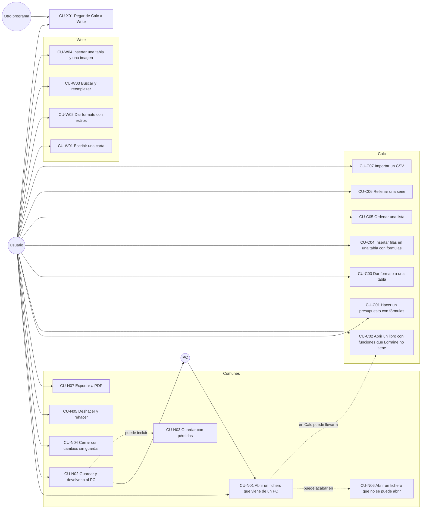

# 02. Casos de uso

Qué hace el usuario con Lorraine y qué responde el programa, paso a paso. Escrito antes de construir: describe lo que
se espera, no lo que ya hace. Cada caso cita los requisitos de [01](01_REQUISITOS.md). Cómo lo hará el código está en
[03](03_FLUJOS.md) y [04](04_ESTADOS.md).

Los casos CU-N valen para los dos programas. Los CU-C son de Calc y los CU-W de Write.

## Actores

| Actor | Quién es |
|---|---|
| Usuario | La persona delante del Amiga. |
| Otro programa | Un programa del Amiga que deja o recoge texto en el portapapeles (un editor, el Shell). También Calc para Write y al revés. |
| PC | El ordenador del que vienen y al que vuelven los ficheros: LibreOffice o Microsoft Office. No habla con Lorraine; solo deja ficheros. |
| Sistema | AmigaOS, MUI, `clipboard.device`, `locale.library`, los datatypes. |

## Mapa

## Casos comunes

### CU-N01 Abrir un fichero que viene de un PC

- **Actor:** Usuario. **Requisitos:** RF-N01, RF-N02, RF-N03, RF-C01, RF-W01, RF-C11.
- **Precondición:** el fichero (`.ods`, `.fods`, `.xlsx`, `.csv`, `.odt`, `.fodt`, `.docx` o `.txt`) está en un disco
  del Amiga.
- **Flujo principal:**
  1. El usuario elige Proyecto › Abrir. Sale el diálogo de ficheros con el filtro de su programa.
  2. Elige el fichero.
  3. El programa mira el contenido y reconoce el formato, sin fiarse de la extensión.
  4. Lee primero los estilos y luego el contenido. Mientras, la barra de estado dice "Abriendo nombre…".
  5. Abre una ventana nueva con el documento. Si la ventana que había estaba vacía y sin cambios, la usa.
  6. Si algo del fichero no se entendió (gráficos, macros, comentarios…), lo apunta en la lista de pérdidas. No
     avisa todavía: avisará al guardar (CU-N03).
- **Alternativas:**
  - 1a. Desde el Shell: `LorraineCalc libro.xlsx`. Mismo flujo desde el paso 3.
  - 1b. Doble clic en el icono del fichero, con Lorraine como herramienta por defecto. Mismo flujo desde el paso 3.
  - 1c. Arrastrar el icono a la ventana o al icono de la aplicación (si MUI lo permite; por decidir).
  - 3a. El fichero tiene la extensión de otro formato (un `.xlsx` llamado `.ods`): se abre como lo que es, sin
    avisar.
  - 3b. Es un formato del otro programa (un `.docx` abierto en Calc): aviso "Esto es un documento de texto. Ábrelo
    con Lorraine Write". No se abre.
  - 5a. En Calc, el libro usa funciones que Lorraine no tiene: CU-C02.
- **Errores:** CU-N06.
- **Postcondición:** el documento está abierto y sin cambios. Su formato de origen y su lista de pérdidas quedan
  guardados con él.

### CU-N02 Guardar y devolverlo al PC

- **Actor:** Usuario. **Requisitos:** RF-N04, RF-N05, RF-C02, RF-C03, RF-W02, RNF-05.
- **Precondición:** un documento abierto, con cambios.
- **Flujo principal:**
  1. El usuario elige Proyecto › Guardar.
  2. El documento se guarda en su formato de origen, con el mismo nombre.
  3. El programa escribe a un fichero temporal en el mismo disco. Si todo fue bien, borra el original y pone el
     temporal en su sitio.
  4. La ventana deja de marcar cambios. La barra de estado dice "Guardado".
  5. El usuario copia el fichero al PC y lo abre con LibreOffice u Office: ve lo mismo que veía en el Amiga.
- **Alternativas:**
  - 1a. Proyecto › Guardar como: diálogo con el nombre y el formato. Si el nombre ya existe, pregunta antes de
    reemplazar.
  - 2a. Documento nuevo, sin formato de origen: actúa como Guardar como, con el formato por defecto (ODF).
  - 2b. Hubo pérdidas al abrir y se guarda en el formato de origen: CU-N03 antes del paso 3.
  - 2c. Se guarda en `.csv` o `.txt`: aviso "Este formato solo guarda el texto (en Calc: solo la hoja actual)",
    con opción de no volver a avisar en esta sesión.
- **Errores:**
  - Disco lleno, protegido o quitado a mitad: el temporal se borra si se puede, el original queda intacto y sale
    el motivo. El documento sigue marcado con cambios.
  - Sin memoria al guardar: mismo trato.
- **Postcondición:** el fichero en disco tiene el contenido del documento. Lo que no se conservó estaba avisado.

### CU-N03 Guardar con pérdidas

- **Actor:** Usuario. **Requisitos:** RF-N06, decisión A9.
- **Precondición:** el documento se abrió con cosas que Lorraine no entiende, y se va a guardar en su formato de
  origen.
- **Flujo principal:**
  1. Antes de escribir, sale un aviso: "Este documento tenía cosas que Lorraine no conserva: gráficos (2),
     comentarios (5). Si lo guardas, se perderán."
  2. Botones: "Guardar igualmente", "Guardar como…" y "Cancelar".
  3. El usuario elige "Guardar igualmente". Se guarda (CU-N02, paso 3).
  4. La lista de pérdidas se vacía: el fichero nuevo ya no las tiene. No vuelve a avisar en este documento.
- **Alternativas:**
  - 3a. "Guardar como…": diálogo de nombre. El original queda con todo lo suyo. El aviso no vuelve para el nombre
    nuevo.
  - 3b. "Cancelar": no se guarda nada.
- **Postcondición:** el usuario sabía qué se perdía antes de perderlo.

### CU-N04 Cerrar con cambios sin guardar

- **Actor:** Usuario. **Requisitos:** RF-N07.
- **Flujo principal:**
  1. El usuario cierra la ventana (o Proyecto › Cerrar, o Salir con varias ventanas).
  2. Si el documento tiene cambios, pregunta: "¿Guardar los cambios de nombre?" con "Guardar", "No guardar" y
     "Cancelar".
  3. "Guardar": CU-N02; si se guarda bien, se cierra. "No guardar": se cierra. "Cancelar": no pasa nada.
- **Alternativas:**
  - 1a. Salir con varios documentos con cambios: pregunta uno a uno. Un "Cancelar" para la salida entera.
  - 2a. Sin cambios: se cierra sin preguntar.
- **Errores:** si el guardado falla, la ventana no se cierra.

### CU-N05 Deshacer y rehacer

- **Actor:** Usuario. **Requisitos:** RF-N08.
- **Flujo principal:**
  1. El usuario hace un cambio (escribe una celda, borra un párrafo, aplica negrita).
  2. Pulsa Amiga+Z. El documento vuelve a como estaba. La selección y el cursor vuelven al sitio del cambio.
  3. Pulsa Amiga+Shift+Z (o Amiga+Y). El cambio se rehace.
- **Alternativas:**
  - 2a. No hay nada que deshacer: la opción del menú está desactivada.
  - 3a. Tras deshacer, el usuario hace un cambio nuevo: lo que se podía rehacer se tira.
- **Notas:** una orden que cambia muchas cosas (pegar un bloque, ordenar, reemplazar todo) se deshace de una vez.
  Si se deshace hasta el punto del último guardado, el documento vuelve a "sin cambios".

### CU-N06 Abrir un fichero que no se puede abrir

- **Actor:** Usuario. **Requisitos:** RF-N03, RNF-03, RNF-04.
- **Flujo principal:**
  1. El usuario abre un fichero (CU-N01).
  2. El programa encuentra un problema y lo dice con un mensaje claro:
     - ZIP roto o fichero cortado: "El fichero está dañado o incompleto."
     - XML roto: "El fichero está dañado: error en content.xml, línea N."
     - Cifrado con contraseña: "El documento está protegido con contraseña. Lorraine no abre documentos cifrados."
     - Formato antiguo (`.xls`, `.doc`): "Formato de Office antiguo. Guárdalo como .xlsx o .docx en el PC."
     - Formato desconocido: "Lorraine no reconoce este fichero."
     - Sin memoria: "No hay memoria para abrir este documento." Lo leído hasta ahí se suelta.
  3. No se abre ninguna ventana nueva. Los demás documentos siguen como estaban.
- **Postcondición:** ni cuelgue, ni memoria perdida.

### CU-N07 Exportar a PDF

- **Actor:** Usuario. **Requisitos:** RF-N12. **Hito:** H9 (detalle pendiente).
- **Flujo principal:**
  1. Proyecto › Exportar a PDF. Diálogo de nombre.
  2. Calc exporta la hoja actual (o su área de impresión); Write, el documento entero.
  3. Se guarda con el mismo cuidado que CU-N02 (temporal y cambio).

## Casos de Calc

### CU-C01 Hacer un presupuesto con fórmulas

- **Actor:** Usuario. **Requisitos:** RF-C06, RF-C07, RF-C08, RF-C09, RF-C10, RF-C12, RF-C13, RF-C22.
- **Precondición:** Calc abierto con un libro nuevo, idioma del sistema en español.
- **Flujo principal:**
  1. En A1 escribe "Concepto", en B1 "Unidades", en C1 "Precio", en D1 "Total". Return baja una fila cada vez; Tab
     pasa a la derecha.
  2. Rellena filas 2 a 6 con conceptos, unidades y precios. Escribe `12,50` y la celda guarda el número 12,5.
  3. En D2 escribe `=B2*C2`. Al pulsar Return la celda muestra el resultado.
  4. Copia D2 y la pega en D3:D6. Cada una calcula su fila (`=B3*C3`…).
  5. En D7 escribe `=SUMA(D2:D6)`. Ve el total.
  6. En D8 escribe `=D7*21%`, en D9 `=D7+D8`.
  7. Cambia unas unidades en B3. D3, D7, D8 y D9 cambian al momento. Nada más se recalcula.
  8. Selecciona C2:D9 y les da formato de moneda. Pone en negrita la fila 1.
  9. Guarda como `presupuesto.xlsx` (CU-N02).
- **Alternativas:**
  - 3a. Escribe la fórmula señalando: teclea `=`, hace clic en B2, teclea `*`, clic en C2, Return (E-02, estado
    "Señalando").
  - 5a. Autosuma: en D7 pulsa la tecla de autosuma; propone `=SUMA(D2:D6)` y Return lo acepta.
  - 5b. Escribe `=SUM(D2:D6)` en inglés: se acepta igual y se muestra como `=SUMA(D2:D6)`.
- **Errores:**
  - Fórmula mal escrita (`=SUMA(D2:D6`): aviso "Falta un paréntesis" y la celda sigue en edición.
  - Función que no existe: la celda da `#¿NOMBRE?` (`#NAME?` en inglés).
  - Referencia circular (`=D7` en D7): la celda da `Err:522`.
  - División por cero: `#¡DIV/0!` (`#DIV/0!`).

### CU-C02 Abrir un libro con funciones que Lorraine no tiene

- **Actor:** Usuario. **Requisitos:** RF-C11, decisión A8.
- **Precondición:** un `.xlsx` hecho en Excel con, por ejemplo, `BDSUMA` o `ESTIMACION.LINEAL`, que Lorraine no tiene.
- **Flujo principal:**
  1. El usuario abre el libro (CU-N01).
  2. Cada fórmula se compila. Las que usan una función desconocida guardan su texto tal cual y el valor que traía el
     fichero.
  3. La hoja se ve con los mismos números que en Excel. Esas celdas llevan una marca en una esquina.
  4. Al ponerse en una de ellas, la barra de estado dice "Lorraine no sabe calcular BDSUMA: se muestra el valor
     guardado".
  5. Si cambia una celda de la que depende, la marcada no se recalcula y conserva su valor. La marca avisa de que
     puede estar desfasada.
  6. Al guardar, la fórmula se escribe tal como venía y con su último valor. Excel la recalculará al abrirla.
- **Alternativas:**
  - 5a. El usuario edita la fórmula marcada: al aceptar, aviso "Lorraine no sabe calcular BDSUMA". Se guarda el
    texto nuevo; el valor queda como `#¿NOMBRE?` hasta que otro programa la recalcule.
- **Notas:** en un `.ods` pasa lo mismo. Al guardar en el otro formato, el nombre de la función se traduce si se
  conoce su equivalente (ver [12](12_FORMATOS.md)); si no, la celda va a la lista de pérdidas.

### CU-C03 Dar formato a una tabla

- **Actor:** Usuario. **Requisitos:** RF-C12, RF-C13, RF-C14, RF-C15.
- **Flujo principal:**
  1. Selecciona un rango.
  2. Usa la barra de formato (negrita, cursiva, alineación, moneda, porcentaje) o Formato › Celdas, con pestañas
     Número, Fuente, Alineación, Bordes y Fondo.
  3. El rango se repinta con el formato nuevo. Es un solo paso para deshacer.
  4. Arrastra el borde de una cabecera de columna para cambiar su ancho, o hace doble clic en él para el ancho
     justo.
  5. Selecciona A1:D1 y elige Formato › Combinar celdas.
- **Alternativas:**
  - 5a. Hay datos en más de una de las celdas a combinar: pregunta si se conserva solo la primera.

### CU-C04 Insertar filas en una tabla con fórmulas

- **Actor:** Usuario. **Requisitos:** RF-C16, RF-C09.
- **Precondición:** el presupuesto de CU-C01.
- **Flujo principal:**
  1. Selecciona la fila 4 y elige Hoja › Insertar filas.
  2. Las filas de la 4 hacia abajo bajan una. `=SUMA(D2:D6)` pasa a ser `=SUMA(D2:D7)`, y cada referencia a lo que
     bajó se ajusta.
  3. Escribe la fila nueva y copia la fórmula del total. La suma la incluye.
- **Alternativas:**
  - 1a. Borrar filas: las referencias a celdas borradas pasan a `#¡REF!`; los rangos que las contenían se encogen.

### CU-C05 Ordenar una lista

- **Actor:** Usuario. **Requisitos:** RF-C18.
- **Flujo principal:**
  1. Selecciona una celda dentro de una lista con cabecera.
  2. Datos › Ordenar. El programa propone el bloque entero y detecta la cabecera.
  3. Elige la columna y el sentido (y hasta otras dos columnas de desempate).
  4. Las filas se ordenan según el idioma (la `ñ` tras la `n`). Un solo paso para deshacer.

### CU-C06 Rellenar una serie

- **Actor:** Usuario. **Requisitos:** RF-C17.
- **Flujo principal:**
  1. Escribe "enero" en A1 y selecciona A1:A12.
  2. Elige Hoja › Rellenar › Serie (o arrastra la esquina de la selección, si D12 lo permite).
  3. Salen los doce meses. Con `1` y `2` en las dos primeras salen `3, 4, 5…`. Con una fecha, días seguidos.

### CU-C07 Importar un CSV

- **Actor:** Usuario. **Requisitos:** RF-C01, RF-C04.
- **Flujo principal:**
  1. Abre un `.csv` (CU-N01).
  2. Sale un diálogo con una vista previa: separador (coma, punto y coma, tabulador), comillas, juego de caracteres
     (UTF-8, Latin-1, Windows-1252) y si la primera fila es cabecera. El programa propone lo que ve más probable.
  3. Acepta. Cada valor se reconoce como número, fecha o texto con las reglas del idioma elegido.

## Casos de Write

### CU-W01 Escribir una carta

- **Actor:** Usuario. **Requisitos:** RF-W04, RF-W05, RF-W06, RF-W07, RF-W10, RF-N04.
- **Precondición:** Write abierto con un documento nuevo (A4, márgenes por defecto).
- **Flujo principal:**
  1. Escribe su dirección. Return empieza un párrafo nuevo.
  2. Selecciona la dirección y la alinea a la derecha.
  3. Escribe la fecha, el saludo y el cuerpo. Las líneas se cortan solas al llegar al margen. Al llenarse la
     página, empieza otra.
  4. Selecciona una palabra con doble clic y la pone en negrita con Amiga+B.
  5. Vuelve con las flechas a corregir el primer párrafo. Cada tecla se ve al momento, también con varias páginas
     detrás (RNF-W02).
  6. Guarda como `carta.docx`.
- **Alternativas:**
  - 3a. Shift+Return: salto de línea dentro del párrafo.
  - 3b. Ctrl+Return: salto de página.
  - 5a. Selección con Shift+flechas o arrastrando con el ratón (D11, D12).
- **Errores:** sin memoria a mitad de escribir: aviso; el texto ya escrito se conserva y se puede guardar.

### CU-W02 Dar formato con estilos

- **Actor:** Usuario. **Requisitos:** RF-W08.
- **Flujo principal:**
  1. Pone el cursor en un párrafo y elige "Título 1" en el desplegable de estilos.
  2. El párrafo toma el formato del estilo. Los que ya llevaban "Título 1" no cambian.
  3. Cambia el estilo "Título 1" (Formato › Estilos): todos los párrafos con ese estilo cambian.
  4. Guarda en `.odt` y en `.docx`: los estilos se conservan con su nombre.
- **Alternativas:**
  - 1a. Un documento de Word con estilos con nombre interno (`Heading1`) y nombre visible ("Título 1"): se muestra
    el visible y se guarda el interno.

### CU-W03 Buscar y reemplazar

- **Actor:** Usuario. **Requisitos:** RF-W09.
- **Flujo principal:**
  1. Edición › Buscar y reemplazar. Escribe lo que busca y por qué reemplazarlo. Marca "Palabra entera" si quiere.
  2. "Buscar": selecciona la siguiente aparición y lleva la vista hasta ella.
  3. "Reemplazar todo": cambia todas y dice cuántas. Un solo paso para deshacer.
- **Alternativas:**
  - 2a. No hay más: "No se encontró" y vuelve a empezar desde arriba si el usuario quiere.

### CU-W04 Insertar una tabla y una imagen

- **Actor:** Usuario. **Requisitos:** RF-W12, RF-W13. **Hito:** H8.
- **Flujo principal:**
  1. Tabla › Insertar: filas y columnas. Sale una tabla al ancho de la página.
  2. Escribe en las celdas; Tab pasa a la siguiente y, en la última, añade una fila.
  3. Insertar › Imagen: diálogo de ficheros. La imagen entra en línea con el texto, al ancho que quepa.
- **Errores:** imagen sin datatype para su formato: "No se puede leer esta imagen".

## Caso entre programas

### CU-X01 Pegar de Calc a Write

- **Actores:** Usuario, Otro programa (aquí, Calc y Write). **Requisitos:** RF-N09, RF-N10.
- **Precondición:** Calc y Write abiertos.
- **Flujo principal:**
  1. En Calc selecciona B2:D7 y copia (Amiga+C).
  2. Calc deja en el portapapeles dos cosas: el texto (celdas separadas por tabuladores, filas por saltos de
     línea, ya formateadas como se ven) y un bloque con formato propio de Lorraine (D18).
  3. En Write pone el cursor y pega (Amiga+V).
  4. Write encuentra el bloque de Lorraine con celdas y lo pega como una tabla, con los valores formateados.
- **Alternativas:**
  - 4a. Antes de H8 (sin tablas en Write), o con Edición › Pegar solo texto: se pega el texto con tabuladores.
  - 4b. De Write a Calc: cada línea es una fila y cada tabulador una columna. Los números se reconocen.
  - 4c. Desde un editor del Amiga: llega solo texto FTXT en Latin-1. Se pasa a UTF-8 al pegar.
  - 4d. Hacia un editor del Amiga: el texto se pasa a Latin-1; lo que no exista se sustituye (D5).
- **Errores:** portapapeles vacío o con algo que no es texto: Pegar no hace nada y la opción está desactivada si se
  puede saber antes.
