# 03. Flujos

Cómo trabajará Lorraine por dentro: diagramas de flujo y de secuencia de los procesos principales. Es el diseño de
partida, antes del código. Los módulos son los de [ARQUITECTURA](../ARQUITECTURA.md); **los nombres de funciones son
propuestas** (en español, con el prefijo de su módulo) y pueden cambiar al escribir el código. Los estados de cada
objeto están en [04](04_ESTADOS.md).

Índice:

| ID | Flujo | Tipo | Programa |
|---|---|---|---|
| F-01 | Arranque y salida | Flujo | Los dos |
| F-02 | Bucle de eventos | Flujo | Los dos |
| F-03 | Abrir un fichero | Secuencia | Los dos |
| F-04 | Detectar el formato | Flujo | Los dos |
| F-05 | Leer una entrada del ZIP a eventos XML | Flujo | Los dos |
| F-06 | Guardar seguro | Flujo | Los dos |
| F-07 | Escribir en una celda | Flujo | Calc |
| F-08 | Reconocer lo escrito | Flujo | Calc |
| F-09 | Compilar una fórmula | Flujo | Calc |
| F-10 | Recalcular | Flujo | Calc |
| F-11 | Pintar la rejilla y repintar una zona | Flujo | Calc |
| F-12 | Una tecla en Write | Secuencia | Write |
| F-13 | Repaginar | Flujo | Write |
| F-14 | Deshacer y rehacer | Flujo | Los dos |
| F-15 | Copiar | Secuencia | Los dos |
| F-16 | Pegar | Flujo | Los dos |

## F-01 Arranque y salida

Igual en los dos programas. Se muestra Calc.

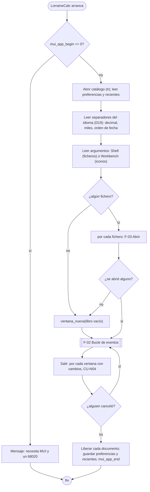

## F-02 Bucle de eventos

Un solo bucle con `mui_wait_event`. Cada ventana tiene su documento. Los números de evento llevan el número de la
ventana (como en Tachyon: `ID_X + k`).

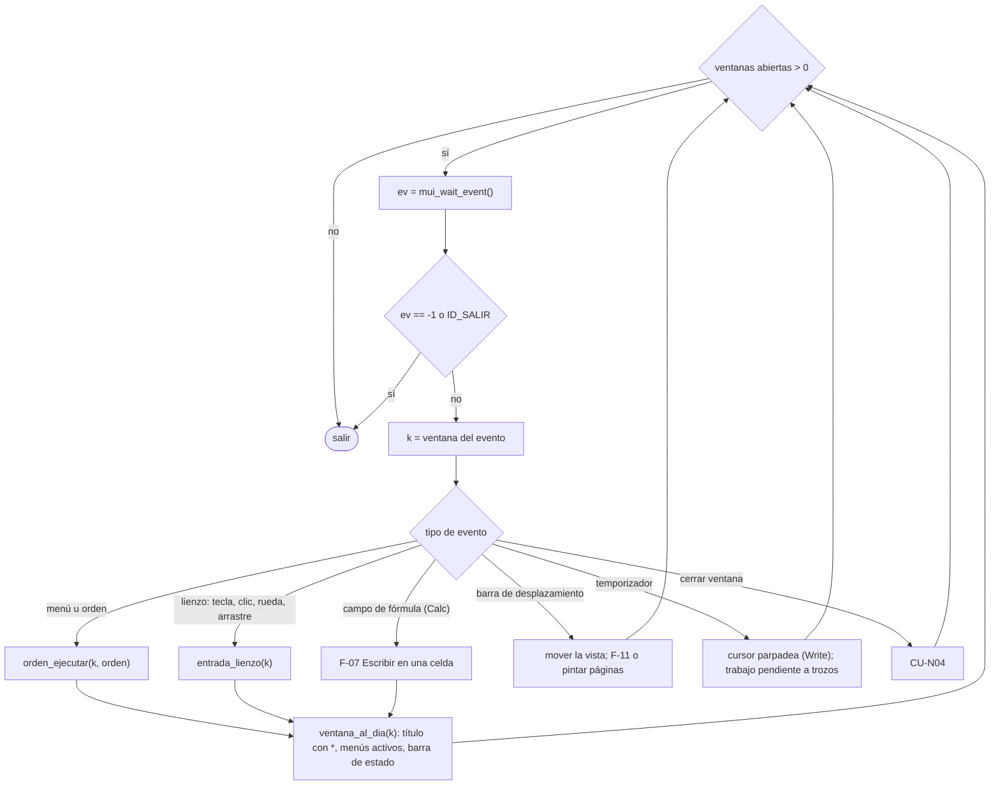

`ventana_al_dia` pone en el título un `*` si hay cambios, activa o desactiva Deshacer, Rehacer, Pegar, Guardar, y
escribe la barra de estado. Se llama tras cada orden, no en cada repintado.

## F-03 Abrir un fichero

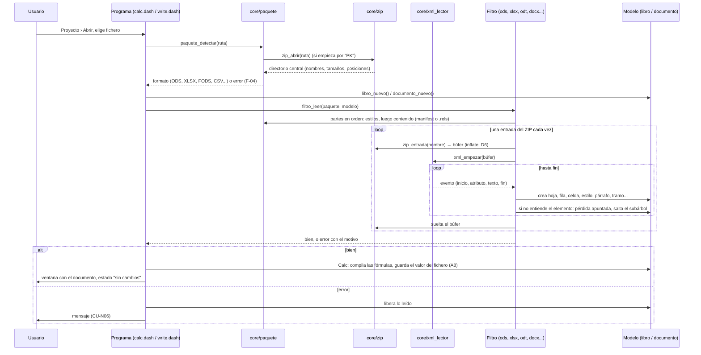

Notas:

- Nunca hay un árbol XML en memoria. El búfer descomprimido de una entrada sí está entero; el mayor del corpus da
  la medida de memoria del pico (ver [10](10_RIESGOS_Y_PENDIENTES.md)).
- La lista de pérdidas se guarda en el modelo con un contador por tipo ("gráficos: 2").
- Saltar un subárbol desconocido es contar profundidad: `xml_saltar()` avanza hasta el fin del elemento abierto.

## F-04 Detectar el formato

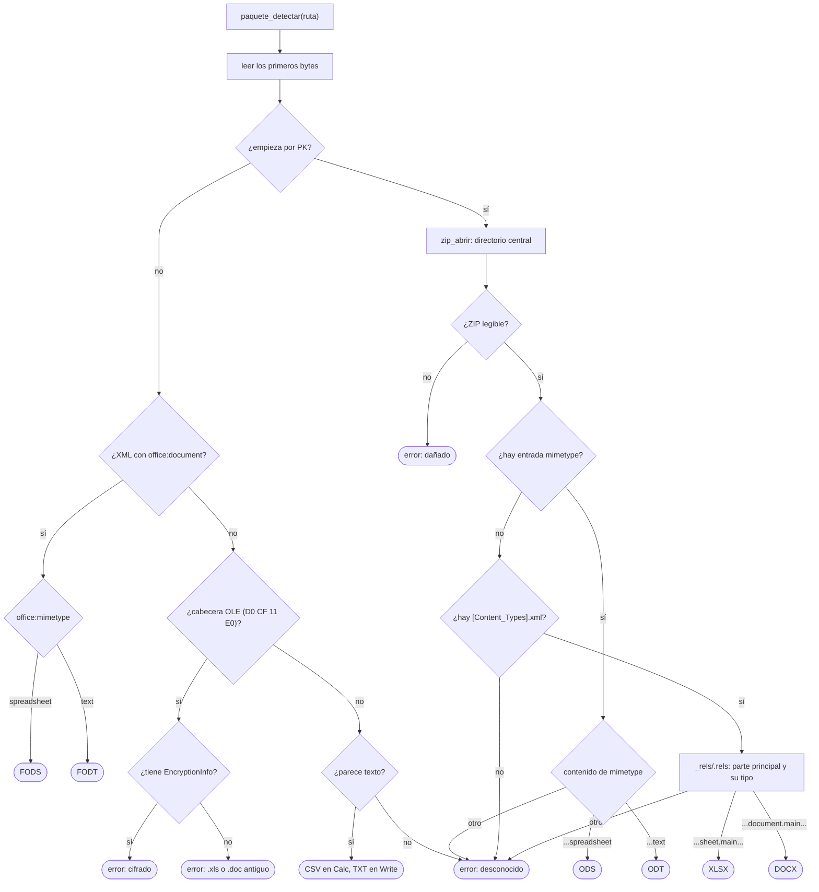

Un ODF cifrado se reconoce en el `manifest.xml` (`manifest:encryption-data`) al leerlo, y da el mismo error que el
OOXML cifrado. Si el formato es del otro programa, el que llama da el aviso de CU-N01 3b.

## F-05 Leer una entrada del ZIP a eventos XML

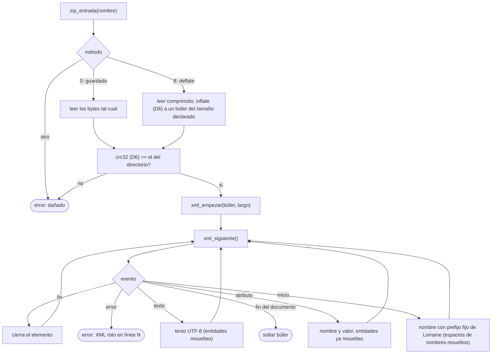

Propuesta para que el lector vaya rápido: los nombres de elemento y atributo se comparan con constantes por número
(una tabla de nombres conocidos que se busca una vez por nombre), no con textos en cada evento. El texto se entrega
como posición y largo dentro del búfer; solo se copia a un `String` si el filtro lo guarda.

## F-06 Guardar seguro

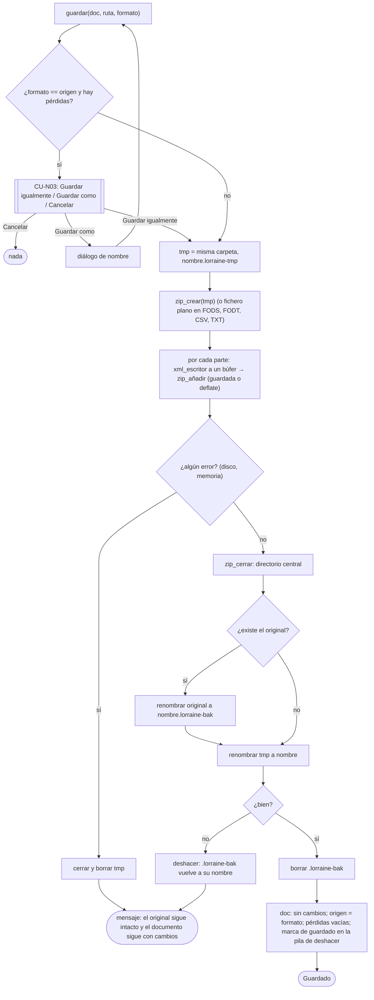

En AmigaOS `Rename` no reemplaza un fichero que existe; por eso el paso por `.lorraine-bak`. Se conservan, si se
puede, el comentario y los bits de protección del original (propuesta; comprobar qué da Dash).

En ODF, la entrada `mimetype` va la primera y sin comprimir; en OOXML, `[Content_Types].xml` primero. Detalle en
[12](12_FORMATOS.md).

## F-07 Escribir en una celda

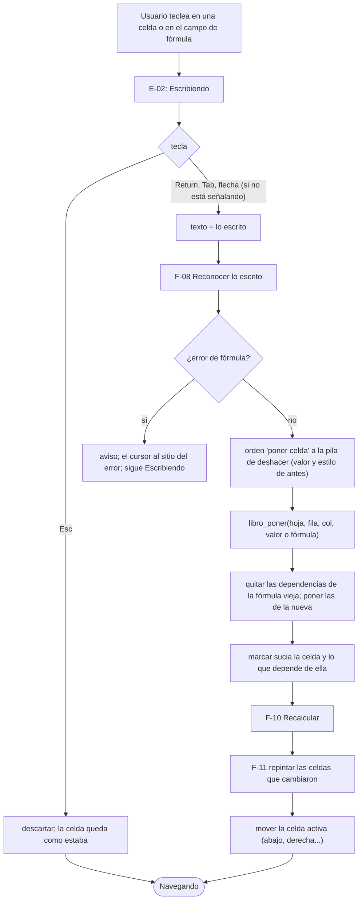

## F-08 Reconocer lo escrito

Las reglas siguen el idioma (D19). Se muestra el español.

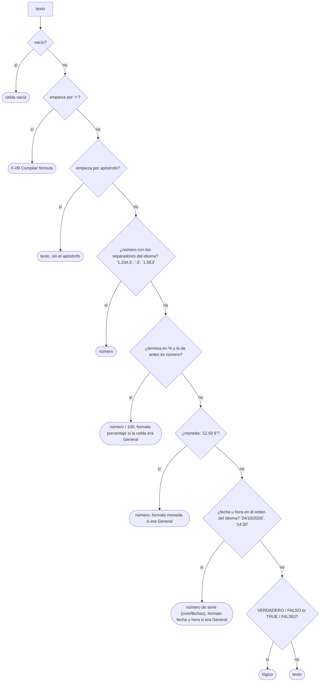

## F-09 Compilar una fórmula

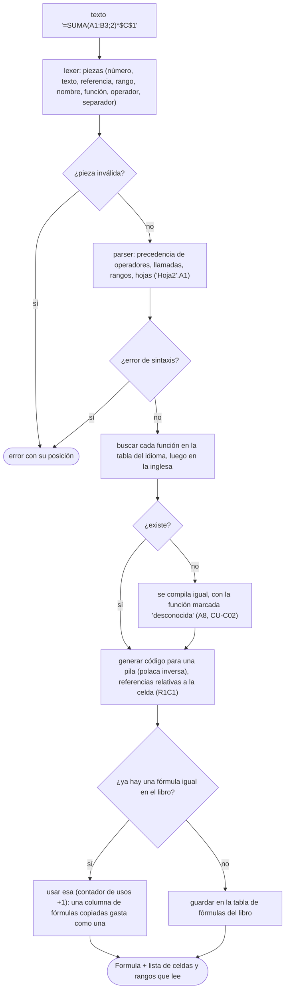

El mismo compilador lee las fórmulas de los ficheros con otra tabla de lexer: OpenFormula en ODF (`of:=`,
`[.A1:.B3]`, `;`) y la sintaxis de OOXML (sin `=`, nombres ingleses, `,`). Detalle en [12](12_FORMATOS.md).

## F-10 Recalcular

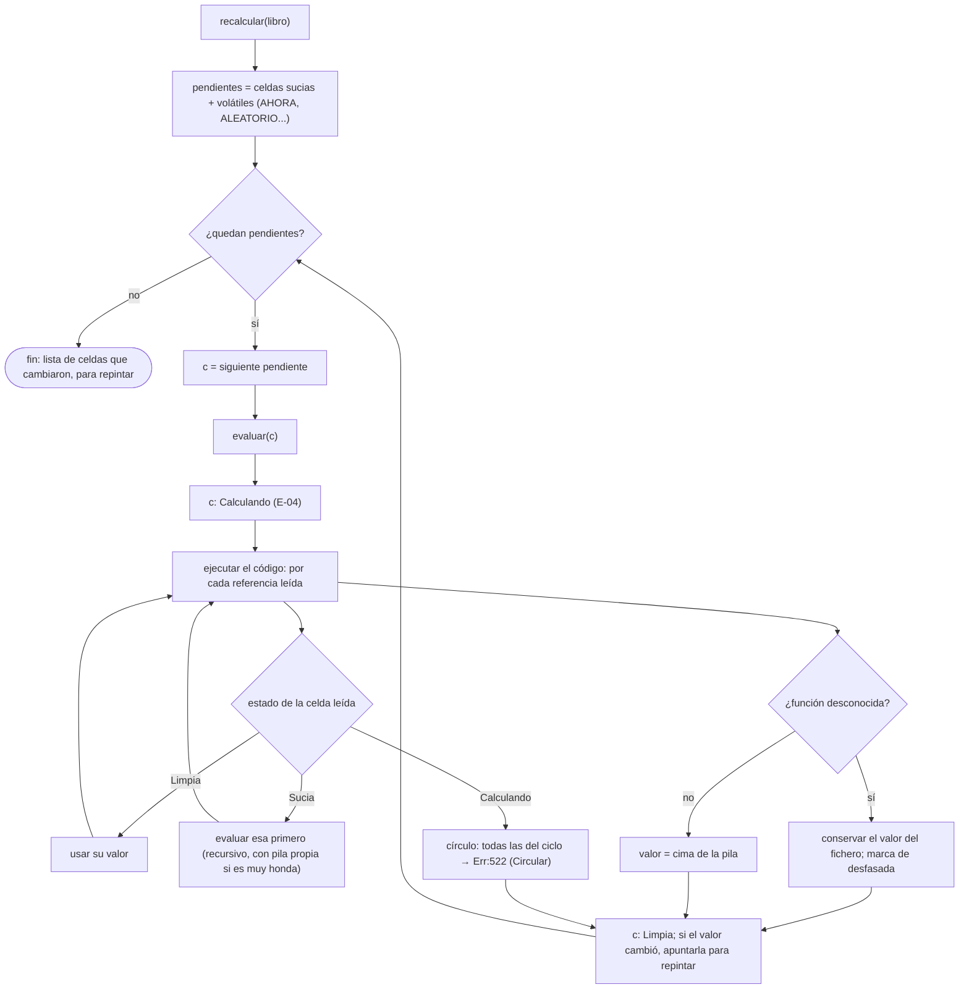

Propuesta: la recursión de "evaluar esa primero" puede ser muy honda (una columna de 10.000 fórmulas que suman la de
encima). Para no agotar la pila del Amiga (16-32 KB), el orden se calcula con una lista de trabajo propia en lugar de
llamadas recursivas. Se decide al escribirlo (H3).

Las dependencias: cada fórmula apunta las celdas y rangos que lee. El índice inverso ("quién lee esta celda") se
guarda por celda para las referencias sueltas y en una lista aparte para los rangos (un rango `A:A` no apunta un
millón de celdas). Al marcar sucias se recorren los dos.

## F-11 Pintar la rejilla y repintar una zona

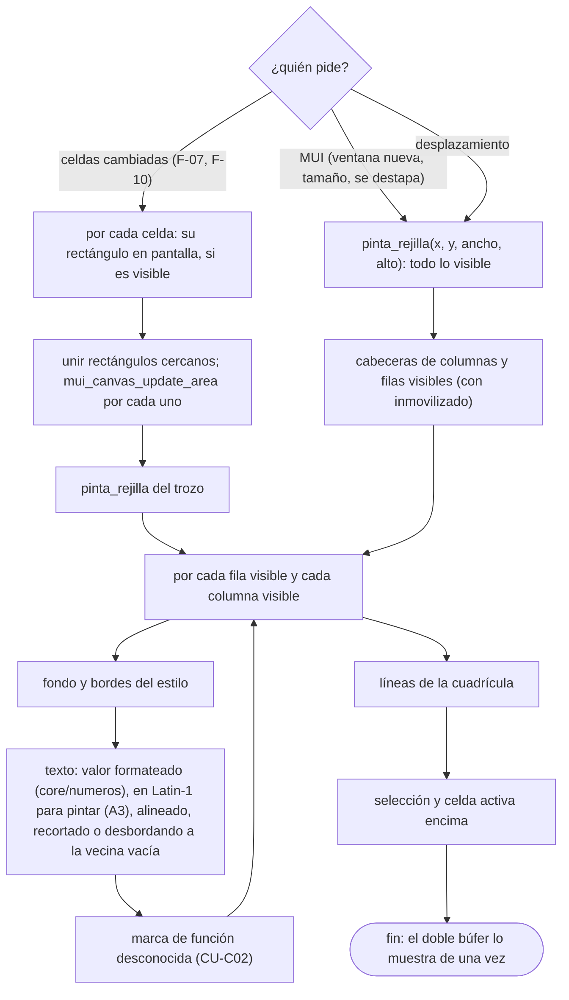

El texto formateado de cada celda visible se guarda en una caché pequeña (propuesta) para no volver a formatear al
desplazar una fila.

## F-12 Una tecla en Write

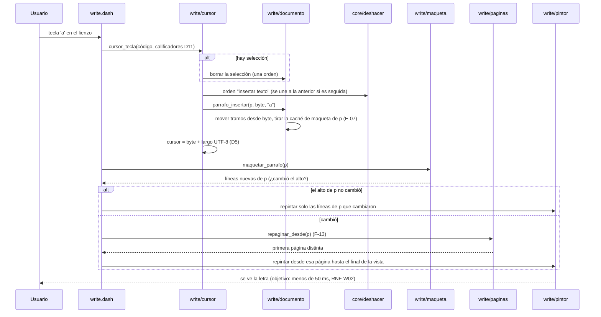

Lo mismo para borrar, pegar o aplicar formato: cambia uno o varios párrafos, se maquetan esos y se repagina desde
el primero.

## F-13 Repaginar

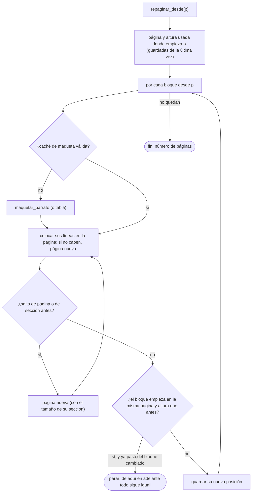

Parar en cuanto un bloque vuelve a caer donde estaba es lo que hace que escribir al principio de un documento largo
no repagine todo. Viudas, huérfanas y "conservar con el siguiente" vienen después (ARQUITECTURA § 6.2).

## F-14 Deshacer y rehacer

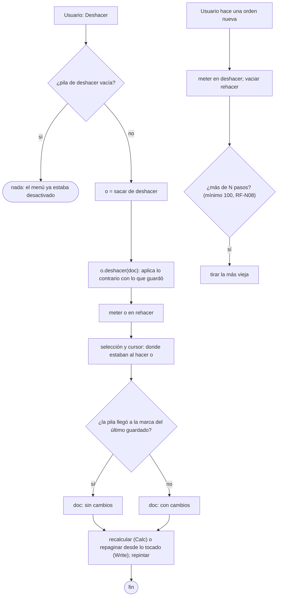

Cada orden (`core/deshacer`) guarda lo justo para volver: el valor viejo de una celda, el texto borrado y sus tramos,
los estilos de antes de un rango. Una orden compuesta (pegar, ordenar, reemplazar todo) agrupa varias.

## F-15 Copiar

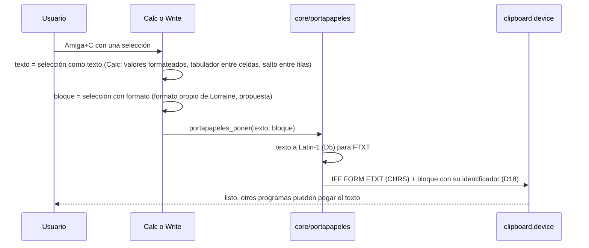

Cortar es copiar más una orden de borrar (una sola para deshacer). Que el bloque propio vaya en el mismo FORM o en
otra unidad del portapapeles se decide en D18.

## F-16 Pegar

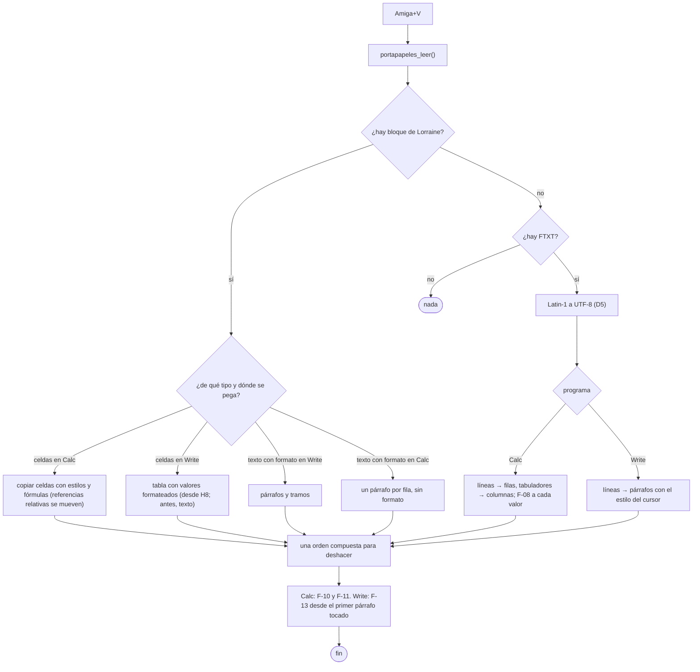

En Calc se pega desde la celda activa. Si pisa celdas con datos, pregunta antes, como LibreOffice (propuesta: con
una casilla para no volver a preguntar).
