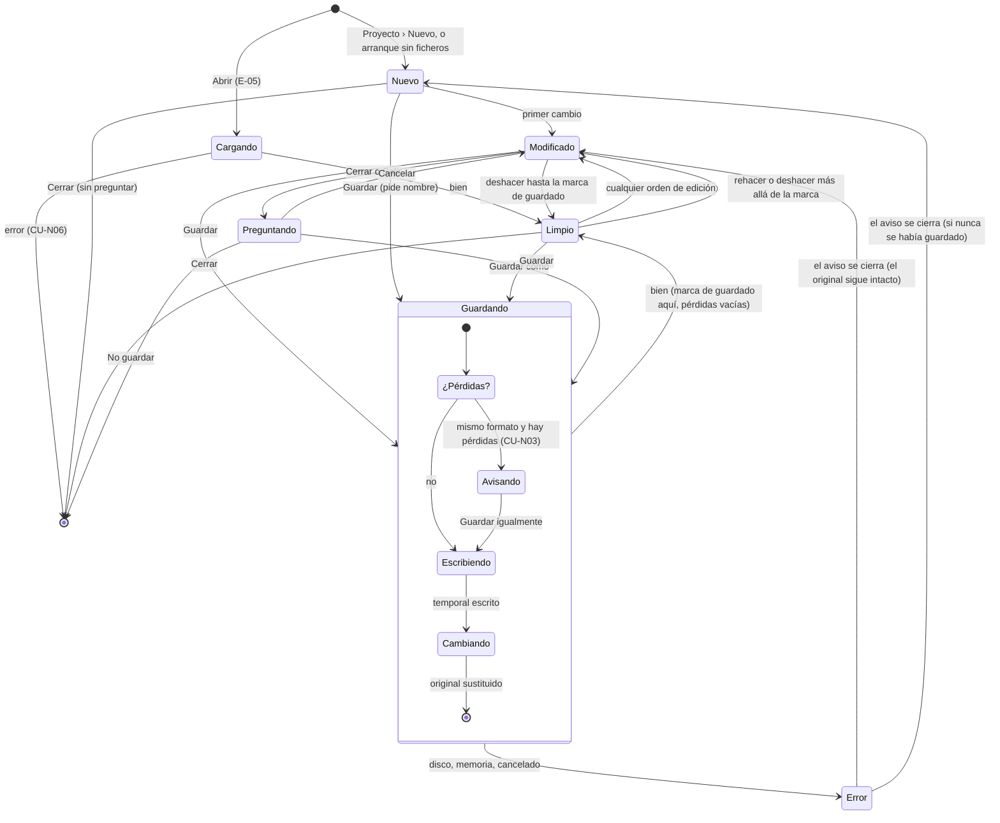
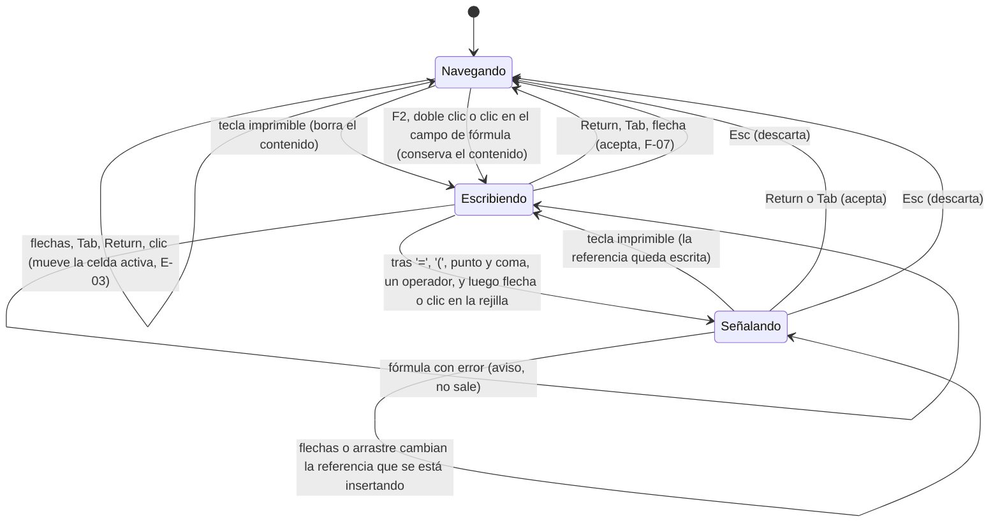
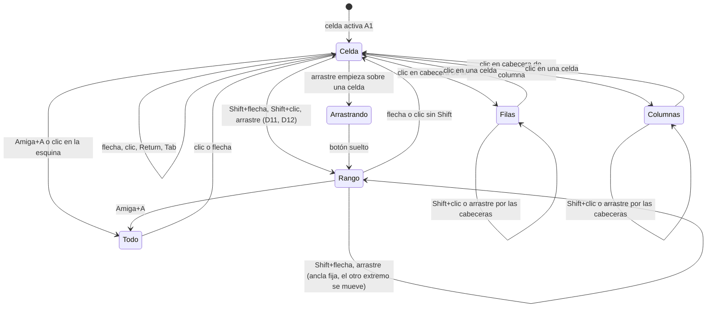
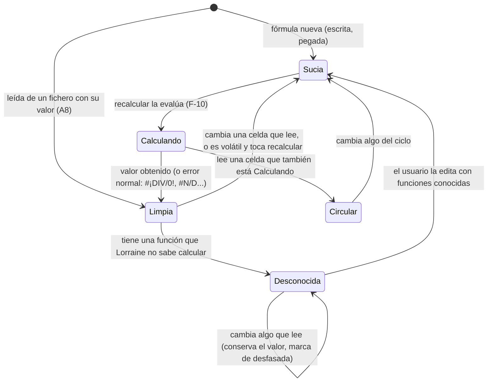
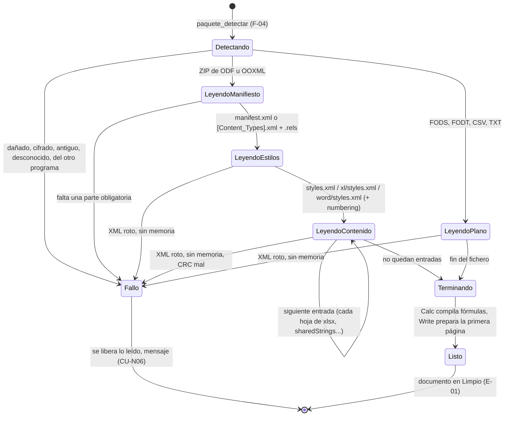
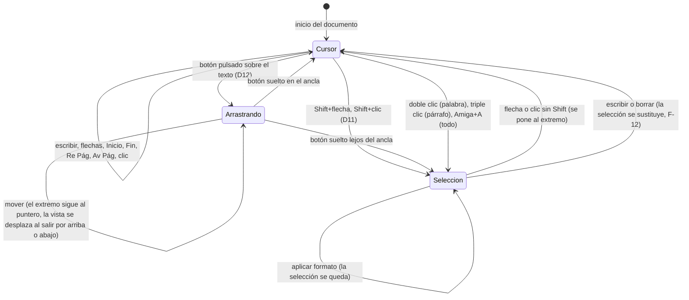
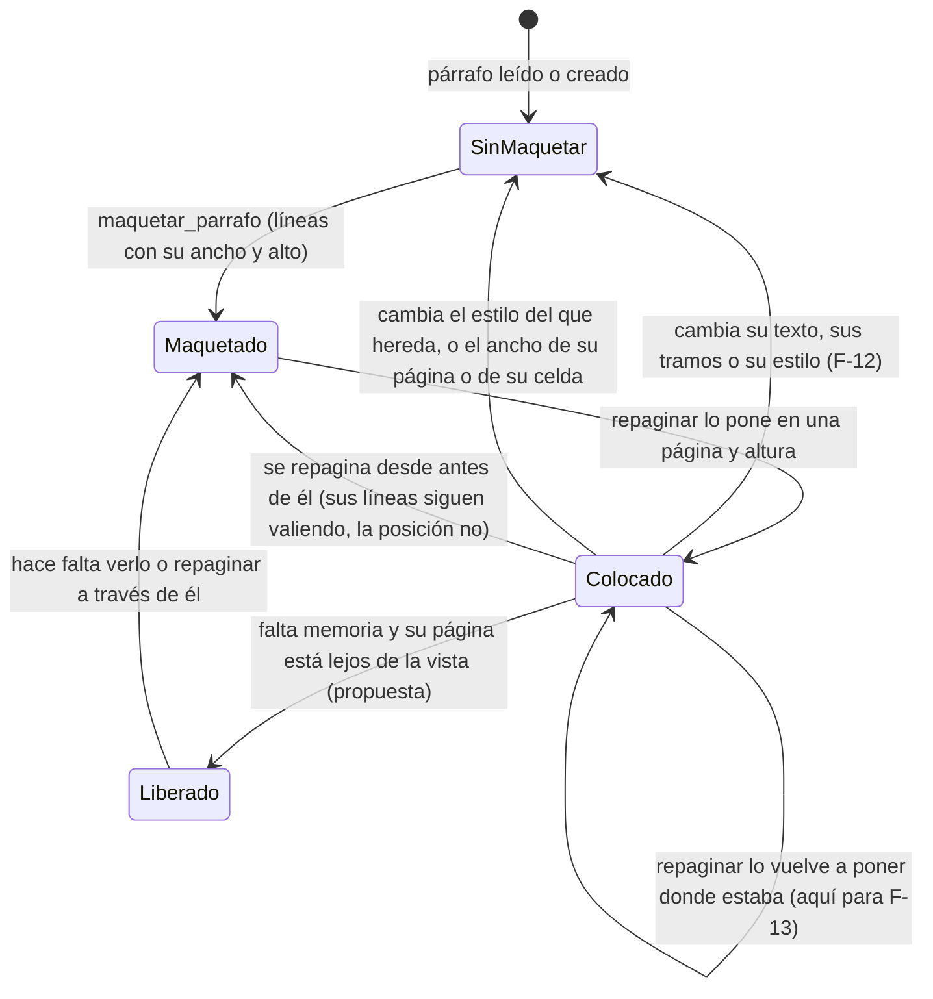

# 04. Diagramas de estado

Los objetos de Lorraine que cambian de estado, y qué los hace cambiar. Diseño de partida, antes del código: los
nombres de campos son propuestas. Los flujos que los mueven están en [03](03_FLUJOS.md); sus datos, en
[05](05_MODELO_DE_DATOS.md).

| ID | Objeto | Programa | Dónde vivirá el estado (propuesta) |
|---|---|---|---|
| E-01 | Un documento | Los dos | `Libro` / `Documento`: `ruta`, `formato`, `cambios` y `cambios_al_guardar`, pila de deshacer con su marca de guardado |
| E-02 | La edición de una celda | Calc | La ventana de Calc: `modo` (navegar, escribir, señalar) |
| E-03 | La selección de Calc | Calc | La ventana: `activa`, `ancla`, `rango` |
| E-04 | El cálculo de una celda | Calc | `Celda`: `calculo` (limpia, sucia, calculando, circular) |
| E-05 | La carga de un fichero | Los dos | El filtro mientras lee |
| E-06 | El cursor y la selección de Write | Write | `write/cursor`: posición, ancla, arrastre |
| E-07 | La caché de maqueta de un párrafo | Write | `Parrafo`: `lineas` (nil = sin maquetar), `alto`, `pagina`, `y` |

## E-01 Un documento

- **Limpio / Modificado** no es un booleano suelto: es comparar la posición de la pila de deshacer con la marca del
  último guardado. Así deshacer hasta lo guardado deja el documento "sin cambios" (F-14).
- Un "Cancelar" en Avisando sale de Guardando sin error, al estado de antes.
- El `*` del título de la ventana sigue a Modificado (F-02, `ventana_al_dia`).

## E-02 La edición de una celda (Calc)

- En Escribiendo, las flechas mueven el cursor dentro del texto si se entró con F2 o en el campo de fórmula; si se
  entró tecleando, aceptan y mueven la celda activa, como en LibreOffice.
- En Señalando, la referencia se escribe en el texto con el formato del idioma (`A1`, `$A$1` con F4, `Hoja2.A1` en
  otra hoja). El rango señalado se dibuja con un marco de color.
- Mientras se está en Escribiendo o Señalando, los menús que cambian el libro (insertar filas, ordenar) están
  desactivados.

## E-03 La selección de Calc

- La selección guarda siempre una celda activa (dentro del rango), el ancla y el rango. Return y Tab dentro de un
  rango recorren sus celdas sin perderlo.
- Selecciones múltiples (Ctrl+clic) quedan fuera de la primera versión (propuesta).
- La barra de estado muestra suma, promedio y cuenta de la selección (RF-C23).

## E-04 El cálculo de una celda (Calc)

Solo las celdas con fórmula tienen este estado. El resto está siempre limpio.

- **Circular** muestra `Err:522`. Todas las celdas del ciclo pasan a Circular, no solo la que lo descubre.
- **Desconocida** es una Limpia con una marca: su valor es el del fichero y no se recalcula (CU-C02). Se propone un
  estado aparte para que la rejilla pinte la marca sin mirar la fórmula.
- Al cerrar Calculando no queda ninguna celda en ese estado; si quedara una, es un fallo del motor (se comprueba en
  los tests).

## E-05 La carga de un fichero

- Dentro de cada estado de lectura, el filtro va entrada a entrada: descomprimir, leer a eventos, soltar el búfer
  (F-05). Solo una entrada descomprimida a la vez.
- En `.xlsx` el orden importa: `sharedStrings.xml` y `styles.xml` antes que las hojas, porque las celdas los citan
  por número. En `.ods`, `styles.xml` antes que `content.xml`.
- Propuesta: con ficheros grandes, la barra de estado muestra el avance por entradas y bytes. Si cancelar la carga
  a mitad hace falta, se añade un estado Cancelando que va a Fallo sin mensaje.

## E-06 El cursor y la selección de Write

- La posición es (párrafo, byte), siempre al inicio de un carácter UTF-8 (D5). Dentro de una tabla, además la celda.
- Al subir y bajar con las flechas se recuerda la x deseada, para no ir derivando hacia la izquierda en líneas
  cortas.
- El cursor parpadea con un temporizador (F-02). Al teclear se reinicia el parpadeo y se ve fijo.

## E-07 La caché de maqueta de un párrafo (Write)

- **Liberado** guarda solo su alto total y su posición. Así repaginar no tiene que maquetarlo de nuevo si no cambió.
  Es una propuesta para RNF-W03; se decide en H6 con las medidas de memoria.
- Cambiar el zoom no invalida la caché, porque la maqueta está en twips (A10): el zoom solo afecta al pintor.
  Cambiar la fuente sí, porque cambian los anchos.
