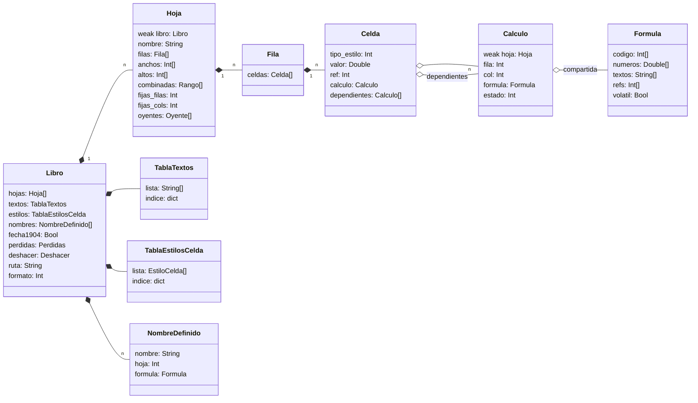
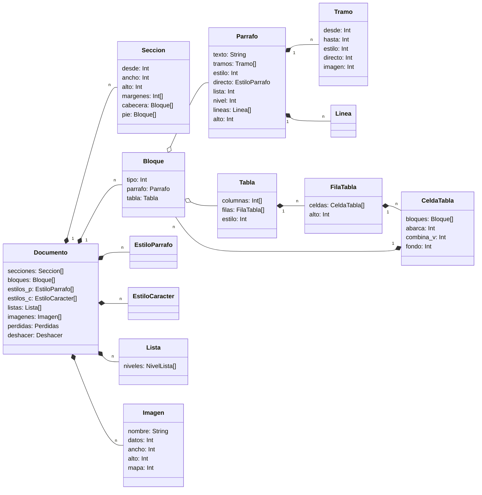

# 05. Modelo de datos

Las estructuras principales de Lorraine Calc y Lorraine Write, quién es dueño de cada una, cuánto gastan y cómo se
guardan las fórmulas por dentro. **Es una propuesta previa al código** (2026-10-24). Los nombres y campos pueden
cambiar al construir; cuando haya código, este documento se pone al día con lo que haya.

Las firmas de las funciones que manejan estas estructuras están en [07](07_MODULOS_E_INTERFACES.md). Cómo se
corresponde cada cosa con ODF y OOXML, en [12](12_FORMATOS.md).

Algunos tipos todavía no existen en Dash. Se marcan con la tarea que los trae ([13](13_DASH.md)):

- `Double` (D1): número de 64 bits. `[Double]` (D2): lista de ellos.
- `{Int: T}` (D9): diccionario con clave entera. Mientras no esté, se usa `{String: T}` con la clave escrita como
  texto, que es más lento.

## 1. Reglas generales

- **Memoria.** Dash cuenta referencias: un struct, una lista o un texto se liberan cuando nadie los usa. Los ciclos
  no se liberan hasta salir. Por eso todo enlace hacia arriba (de hijo a padre) es `weak`.
- **Lo que viene de C es un `Int`** (un puntero): búferes, mapas de bits de imágenes, fuentes TrueType. Se libera a
  mano con su función (`buffer_free`, `image_free`, `fuente_liberar`...).
- **Un documento abierto es dueño de todo lo suyo.** Un `Libro` en Calc, un `Documento` en Write. Al cerrar la
  ventana se suelta y se libera entero.
- **Nada de árboles XML.** Los filtros leen a eventos y llenan directamente estas estructuras (decisión A2).
- **Prueba:** `--memcheck` de Dash. Abrir, editar y cerrar cada documento del corpus deja 0 objetos vivos (RNF-02).

## 2. Unidades y juego de caracteres

- **Longitudes: twips enteros** (1/1440 de pulgada; decisión A10). Un punto son 20 twips; un centímetro, unos 567.
  Se usan para márgenes, sangrías, anchos de columna, altos de fila **y tamaños de letra** (11 pt = 220 twips), para
  no mezclar unidades. La conversión desde cada formato está en [12](12_FORMATOS.md) § 5.
- **Colores:** `Int` con `0xRRGGBB`. `-1` es "automático" (el del sistema o el heredado).
- **Texto: UTF-8** dentro de los `String` de Dash (decisión A3). Un `String` de Dash son bytes; Lorraine guarda en
  ellos UTF-8 tal cual llega del fichero. Solo se pasa a Latin-1 al pintar con fuentes del Amiga (`u8_a_latin1`,
  luego `utf8_to_latin1` de D5). Las posiciones dentro de un texto (cursor, tramos) son **bytes**, siempre en el
  inicio de un carácter.
- **"Heredado":** en los estilos, un campo que vale `-1` (o `nil` en textos) no está puesto y se toma del padre.

## 3. Lorraine Calc

### 3.1 Diagrama de clases



### 3.2 Structs (propuesta)

```ruby
struct Libro
    hojas: [Hoja]
    textos: TablaTextos            # textos compartidos (§ 3.4)
    estilos: TablaEstilosCelda     # estilos de celda deduplicados (§ 3.5)
    nombres: [NombreDefinido]
    fecha1904: Bool = false        # sistema de fechas de 1904 (§ 3.7)
    perdidas: Perdidas             # lo que no se entendió al abrir (§ 5.2)
    deshacer: Deshacer             # pila de órdenes (§ 5.1)
    ruta: String                   # nil si es nuevo
    formato: Int = 0               # FMT_ODS, FMT_FODS, FMT_XLSX, FMT_CSV (core/paquete)
    cambios: Int = 0               # sube con cada orden; "modificado" = cambios != cambios_al_guardar
    cambios_al_guardar: Int = 0
end

struct Hoja
    weak libro: Libro
    nombre: String
    filas: [Fila]                  # índice = número de fila desde 0; nil donde no hay nada
    anchos: [Int]                  # twips por columna; -1 = el ancho por defecto; negativo < -1 = oculta (§ 3.6)
    altos: [Int]                   # twips por fila; igual que anchos
    ancho_defecto: Int = 1450      # twips (comprobar con LibreOffice: 2,258 cm)
    alto_defecto: Int = 255        # twips (12,75 pt; comprobar)
    combinadas: [Rango]
    fijas_filas: Int = 0           # filas inmovilizadas arriba
    fijas_cols: Int = 0
    oyentes: [Oyente]              # fórmulas que leen rangos (§ 3.8)
end

struct Fila
    celdas: [Celda]                # índice = número de columna desde 0; nil donde no hay nada
end

struct Celda
    tipo_estilo: Int = 0           # bits 0-3: tipo (T_VACIA, T_NUMERO, T_TEXTO, T_LOGICO, T_ERROR);
                                   # bits 8-31: número de estilo en Libro.estilos
    valor: Double                  # número, lógico (0/1), número de error; con fórmula, su resultado
    ref: Int = -1                  # texto: número en Libro.textos (también el resultado de texto de una fórmula)
    calculo: Calculo = nil         # nil si la celda no tiene fórmula
    dependientes: [Calculo] = nil  # fórmulas que leen esta celda sola (no por rango); casi siempre nil
end

struct Calculo                     # una fórmula puesta en una celda concreta
    weak hoja: Hoja
    fila: Int
    col: Int
    formula: Formula               # compartida entre todas las celdas con la misma fórmula relativa
    estado: Int = 0                # C_LIMPIA, C_SUCIA, C_CALCULANDO (para detectar círculos), C_SIN_FUNCION
end

struct Formula
    codigo: [Int]                  # código de pila (§ 3.9)
    numeros: [Double]              # constantes numéricas que usa el código (D2)
    textos: [String]               # constantes de texto
    refs: [Int]                    # referencias que lee, ya decodificadas para el grafo (§ 3.8)
    volatil: Bool = false          # usa AHORA, HOY, ALEATORIO...: se recalcula siempre
    clave: String                  # el texto canónico (R1C1); sirve para compartirla
end

struct NombreDefinido
    nombre: String
    hoja: Int = -1                 # -1: del libro; si no, solo vale en esa hoja
    formula: Formula               # normalmente una referencia o un rango absolutos
    oculto: Bool = false
end

struct Rango
    hoja: Int
    f1: Int
    c1: Int
    f2: Int
    c2: Int
end
```

### 3.3 Dueños y vida

| Objeto | Dueño | Nace | Muere |
|---|---|---|---|
| `Libro` | La ventana del documento | Al abrir o con Nuevo | Al cerrar la ventana |
| `Hoja` | `Libro.hojas` | Al leerla o al insertarla | Al borrarla (si la orden se puede deshacer, la guarda la `Orden`) |
| `Fila`, `Celda` | La lista de su hoja o fila | Al escribir algo en ella o al leerla | Al vaciarla del todo (valor, estilo y dependientes), al borrar filas |
| `Calculo` | `Celda.calculo` | Al poner una fórmula | Al quitarla; los `dependientes` de otras celdas lo sueltan en ese momento |
| `Formula` | Todos los `Calculo` que la usan | Al compilar un texto de fórmula nuevo | Cuando la suelta el último `Calculo` (contador de Dash) |
| Texto compartido | `Libro.textos` | Al leer o escribir un texto nuevo | Se queda hasta guardar; al guardar se compacta |

Enlaces hacia arriba `weak`: `Hoja.libro`, `Calculo.hoja`. `Celda.dependientes` apunta a `Calculo` de otras celdas
sin formar ciclo: el `Calculo` no apunta a la celda que lee, sino a su `Formula`.

### 3.4 Textos compartidos

Como `sharedStrings` de OOXML. `TablaTextos.lista` guarda cada texto distinto una vez; `indice` (`{String: Int}`)
da su número. Una celda de texto guarda ese número en `ref`. Al leer un `.xlsx`, la tabla del fichero se carga tal
cual. Al guardar, se recorren las celdas, se rehace la lista solo con los textos usados y se escribe.

### 3.5 Estilos de celda

```ruby
struct EstiloCelda
    fuente: String = nil           # nil = la del estilo por defecto
    tamano: Int = -1               # twips
    negrita: Int = -1              # -1 heredado, 0 no, 1 sí (igual cursiva, subrayado, tachado)
    cursiva: Int = -1
    subrayado: Int = -1
    tachado: Int = -1
    color: Int = -1
    fondo: Int = -1
    borde_arriba: Int = 0          # bits 0-23 color, 24-27 grosor, 28-31 tipo de línea; 0 = sin borde
    borde_abajo: Int = 0
    borde_izq: Int = 0
    borde_der: Int = 0
    alin_h: Int = 0                # A_GENERAL, A_IZQ, A_CENTRO, A_DER, A_JUSTIFICADO, A_RELLENAR
    alin_v: Int = 0                # A_ABAJO (por defecto), A_CENTRO_V, A_ARRIBA
    ajustar: Bool = false          # ajustar texto a la celda
    sangria: Int = 0
    formato_num: Int = 0           # número en core/numeros (el código ya leído); 0 = General
end
```

`TablaEstilosCelda` deduplica: cada combinación de campos se guarda una vez, con una clave de texto que los junta
(`indice: {String: Int}`). El estilo 0 es el por defecto. Cambiar la negrita de mil celdas crea, como mucho, un
estilo nuevo, y las mil celdas cambian su número.

### 3.6 Anchos, altos y ocultas

`anchos[c]` vale `-1` si la columna usa el ancho por defecto. Una columna oculta guarda su ancho en negativo menos
uno (`-ancho - 2`), para recuperarlo al mostrarla. Lo mismo para filas. Las listas solo llegan hasta la última
columna o fila con algo distinto del defecto.

### 3.7 Fechas y horas

Una fecha es un número de serie (`Double`): días desde el 30-12-1899, con la hora como fracción de día. Así lo
guardan Excel y LibreOffice. Los detalles del 29-2-1900 falso y del sistema 1904 están en [12](12_FORMATOS.md) § 3.6.
`core/fechas` hace las cuentas; `Libro.fecha1904` dice qué sistema usa el libro.

### 3.8 Grafo de dependencias

- **Referencias a una celda** (`A1`, `$B$2`): el `Calculo` se apunta en `dependientes` de la celda que lee. Si la
  celda está vacía, se crea vacía para poder apuntarlo.
- **Referencias a un rango** (`A1:A1000`): apuntarse en mil celdas sería caro. Se guarda un `Oyente` en la hoja:

```ruby
struct Oyente
    calculo: Calculo
    f1: Int
    c1: Int
    f2: Int
    c2: Int
end
```

  `Hoja.oyentes` se reparte por bloques de columnas (propuesta: una lista por cada 64 columnas) para no recorrerlos
  todos en cada cambio. **Medir en H3** con libros reales antes de fijarlo.
- **Al cambiar una celda:** se marcan `C_SUCIA` sus dependientes y los oyentes cuyo rango la contiene, y lo que
  depende de ellos, recursivamente. Luego se calculan las sucias. Una fórmula que, al calcularse, pide una celda
  en estado `C_CALCULANDO` está en un círculo: da `Err:522`.
- **Volátiles:** las fórmulas con `volatil` se marcan sucias en cada recálculo.

### 3.9 Código de las fórmulas

La fórmula se compila a una lista de enteros para una máquina de pila (notación polaca inversa). Cada instrucción
es un código de operación seguido de sus operandos.

**Referencias relativas.** Como en R1C1: una referencia relativa se guarda como desplazamiento desde la celda de la
fórmula. `=A1*2` escrita en `B1` y copiada a `B2...B1000` es siempre "la celda de una columna a la izquierda, misma
fila, por 2". Por eso las mil celdas comparten una `Formula` (decisión A7).

Una referencia ocupa 3 enteros:

| Entero | Contenido |
|---|---|
| 1 | Hoja: `-1` la misma; si no, su número en el libro |
| 2 | Fila: desplazamiento (relativa) o número absoluto desde 0 |
| 3 | Columna (bits 0-15: desplazamiento o número absoluto, con signo) y marcas (bit 16 fila absoluta, bit 17 columna absoluta, bit 18 referencia rota `#REF!`) |

**Códigos de operación (propuesta):**

| Código | Operandos | Qué hace |
|---|---|---|
| `OP_NUM` | índice en `numeros` | Apila un número |
| `OP_TEXTO` | índice en `textos` | Apila un texto |
| `OP_LOGICO` | 0 o 1 | Apila VERDADERO o FALSO |
| `OP_ERROR` | número de error | Apila un error escrito tal cual en la fórmula |
| `OP_REF` | referencia (3) | Apila una referencia a una celda |
| `OP_RANGO` | referencia (3) + referencia (3) | Apila un rango |
| `OP_NOMBRE` | índice en `Libro.nombres` | Apila lo que da un nombre definido |
| `OP_SUMA`, `OP_RESTA`, `OP_MULT`, `OP_DIV`, `OP_POT` | — | Aritmética con los dos de arriba |
| `OP_NEG`, `OP_PORCENTAJE` | — | Cambio de signo y `%` del de arriba |
| `OP_CONCAT` | — | `&` |
| `OP_IGUAL`, `OP_DISTINTO`, `OP_MENOR`, `OP_MENOR_IGUAL`, `OP_MAYOR`, `OP_MAYOR_IGUAL` | — | Comparaciones |
| `OP_UNION`, `OP_INTERSECCION` | — | Unión (`~` en ODF, `,` entre paréntesis en Excel) e intersección (espacio en Excel, `!` en ODF) |
| `OP_FUNC` | id de función, número de argumentos | Llama a una función de la tabla de `calc/funciones_*` |
| `OP_SALTA_SI_FALSO` | desplazamiento | Para `SI`: salta la rama que no toca sin evaluarla |
| `OP_SALTA` | desplazamiento | Fin de la rama del `SI` |
| `OP_SALTA_SI_NO_ERROR` | desplazamiento | Para `SI.ERROR`: solo evalúa la alternativa si hay error |
| `OP_FIN` | — | Fin; el de arriba es el resultado |

`SI`, `SI.ERROR` y `SI.ND` se compilan con saltos para no evaluar la rama que no toca. El resto de funciones evalúa
todos sus argumentos. Una función que no está en la tabla compila a `OP_FUNC` con un id "desconocida": la celda se
queda con el valor guardado en el fichero y estado `C_SIN_FUNCION` (decisión A8, RF-C11).

**Valores en la pila del evaluador:**

```ruby
struct Valor
    tipo: Int                      # V_NUMERO, V_TEXTO, V_LOGICO, V_ERROR, V_REF, V_RANGO, V_VACIO
    num: Double                    # número, lógico o número de error
    texto: String = nil
    hoja: Int = -1                 # V_REF y V_RANGO
    f1: Int = 0
    c1: Int = 0
    f2: Int = 0
    c2: Int = 0
end
```

El evaluador reutiliza una lista de `Valor` como pila, sin crear structs nuevos en cada paso.

### 3.10 Errores

Los números son los de la función `TIPO.DE.ERROR` de Excel, para guardarlos sin traducir.

| N.º | Error | Cuándo |
|---|---|---|
| 1 | `#NULL!` | Intersección vacía de dos rangos |
| 2 | `#DIV/0!` | División por cero |
| 3 | `#VALUE!` | Tipo de argumento equivocado (un texto donde va un número) |
| 4 | `#REF!` | Referencia a una celda que ya no existe (fila o columna borrada) |
| 5 | `#NAME?` | Nombre o función que no se conoce |
| 6 | `#NUM!` | Número no válido (raíz de negativo, resultado demasiado grande) |
| 7 | `#N/A` | Valor no disponible (BUSCARV sin coincidencia, `NOD()`) |
| 522 | `Err:522` | Referencia circular, como LibreOffice. Cómo se guarda en cada formato: [12](12_FORMATOS.md) § 3.7 |

En español, LibreOffice muestra los mismos textos (`#DIV/0!`, `#N/A`...). **Comprobar** si Excel en español los
traduce (`#¡DIV/0!`, `#N/D`): si es así, se muestran traducidos con el catálogo y se guardan siempre en inglés.

### 3.11 Cuánto gasta una celda

Estimación, sin medir. La cabecera de un struct de Dash (contador de referencias y demás) está por medir (D17); se
supone de 16 bytes.

| Parte | Bytes |
|---|---|
| Cabecera del struct | 16 (supuesto) |
| `tipo_estilo` | 4 |
| `valor` (`Double`) | 8 |
| `ref` | 4 |
| `calculo` | 4 |
| `dependientes` | 4 |
| Hueco en `Fila.celdas` | 4 |
| **Celda con número** | **44** (la meta es menos de 40: § 9 de la arquitectura) |
| `Calculo` (solo celdas con fórmula) | ~36 más |
| `Formula` | una por fórmula distinta, no por celda |

El reparto de la memoria en bloques de 8 bytes de Dash redondea hacia arriba. Para bajar de 40 se puede quitar
`dependientes` de la celda y guardarlo en un diccionario de la hoja (`{Int: [Calculo]}`, D9), porque casi siempre
es `nil`. Se decide al medir en H2.

Ejemplo de RNF-C03: 20.000 celdas con 2.000 fórmulas son unos 880 KB de celdas, 72 KB de cálculos y las listas de
filas, más los textos. Holgado frente a los 8 MB.

**Riesgo:** una hoja con algo en la fila 1.000.000 crea una lista de un millón de huecos (4 MB). Si aparece en el
corpus, las filas pasan a guardarse por bloques. Está en [10](10_RIESGOS_Y_PENDIENTES.md).

## 4. Lorraine Write

### 4.1 Diagrama de clases



### 4.2 Structs (propuesta)

```ruby
struct Documento
    secciones: [Seccion]           # al menos una
    bloques: [Bloque]              # el cuerpo, en orden
    estilos_p: [EstiloParrafo]     # 0 = "Normal" / "Default Paragraph Style"
    estilos_c: [EstiloCaracter]    # 0 = sin estilo de carácter
    formatos_c: [EstiloCaracter]   # formato directo de los tramos, deduplicado (como los estilos automáticos)
    listas: [Lista]
    imagenes: [Imagen]
    perdidas: Perdidas
    deshacer: Deshacer
    ruta: String
    formato: Int = 0               # FMT_ODT, FMT_FODT, FMT_DOCX, FMT_TXT
    cambios: Int = 0
    cambios_al_guardar: Int = 0
end

struct Seccion
    desde: Int                     # primer bloque de la sección
    ancho: Int = 11906             # twips (A4)
    alto: Int = 16838
    horizontal: Bool = false
    margen_arriba: Int = 1134      # twips (2 cm)
    margen_abajo: Int = 1134
    margen_izq: Int = 1134
    margen_der: Int = 1134
    dist_cabecera: Int = 0
    dist_pie: Int = 0
    cabecera: [Bloque] = nil
    pie: [Bloque] = nil
    primera_distinta: Bool = false # cabecera y pie distintos en la primera página (fase posterior)
end

struct Bloque
    tipo: Int                      # B_PARRAFO o B_TABLA (Dash no tiene herencia: un campo u otro)
    parrafo: Parrafo = nil
    tabla: Tabla = nil
end

struct Parrafo
    texto: String                  # UTF-8. "\t" tabulador, "\n" salto de línea, U+FFFC imagen en línea
    tramos: [Tramo]                # cubren todo el texto, ordenados y sin huecos
    estilo: Int = 0                # en Documento.estilos_p
    directo: EstiloParrafo = nil   # formato de párrafo puesto a mano (nil = ninguno)
    lista: Int = -1                # en Documento.listas; -1 = no es de una lista
    nivel: Int = 0
    salto_pagina: Bool = false     # empieza en una página nueva
    lineas: [Linea] = nil          # caché de maqueta; nil = hay que rehacerla
    alto: Int = 0                  # twips, con la caché hecha; se guarda aunque se tire la caché
    pagina: Int = -1               # página donde empieza (write/paginas); -1 = sin colocar
    y: Int = 0                     # twips desde lo alto de esa página
end

struct Tramo
    desde: Int                     # byte del texto del párrafo
    hasta: Int                     # byte siguiente al último
    estilo: Int = 0                # estilo de carácter con nombre (Documento.estilos_c)
    directo: Int = 0               # formato directo (Documento.formatos_c); 0 = ninguno
    imagen: Int = -1               # si el tramo es una imagen en línea: su número en Documento.imagenes
end

struct Linea                       # resultado de la maqueta (write/maqueta)
    desde: Int
    hasta: Int
    ancho: Int                     # twips
    alto: Int
    base: Int                      # línea base desde arriba
end

struct Tabla
    columnas: [Int]                # anchos en twips (la rejilla)
    filas: [FilaTabla]
    estilo: Int = -1
    bordes: Int = 0                # mismo empaquetado que en Calc
end

struct FilaTabla
    weak tabla: Tabla
    celdas: [CeldaTabla]
    alto: Int = -1                 # -1 = automático
    cabecera: Bool = false         # se repite en cada página
end

struct CeldaTabla
    weak fila: FilaTabla
    bloques: [Bloque]              # al menos un párrafo
    abarca: Int = 1                # columnas que ocupa
    combina_v: Int = 0             # 0 nada, 1 empieza combinación vertical, 2 sigue la de arriba
    fondo: Int = -1
    bordes: [Int] = nil            # arriba, abajo, izq, der; nil = los de la tabla
end

struct EstiloParrafo
    nombre: String                 # el del fichero (styleId en OOXML, style:name en ODF)
    visible: String                # el que se enseña
    padre: Int = -1
    siguiente: Int = -1            # estilo del párrafo que sigue al pulsar Return
    alineacion: Int = -1           # A_IZQ, A_CENTRO, A_DER, A_JUSTIFICADO
    sangria_izq: Int = -1          # twips
    sangria_der: Int = -1
    sangria_primera: Int = -1      # negativa = sangría francesa
    antes: Int = -1                # espacio antes, twips
    despues: Int = -1
    interlineado: Int = -1         # bits 0-27 valor, 28-31 tipo (proporcional en 1/240, exacto, mínimo)
    tabs: [Int] = nil              # posiciones (twips) con el tipo en los bits altos
    car: EstiloCaracter = nil      # formato de carácter por defecto del párrafo
    conservar_siguiente: Int = -1
end

struct EstiloCaracter
    nombre: String = nil
    padre: Int = -1
    fuente: String = nil
    tamano: Int = -1               # twips
    negrita: Int = -1              # -1 heredado, 0, 1 (igual las demás marcas)
    cursiva: Int = -1
    subrayado: Int = -1
    tachado: Int = -1
    color: Int = -1
    resaltado: Int = -1
    posicion: Int = -1             # 0 normal, 1 superíndice, 2 subíndice
end

struct Lista
    niveles: [NivelLista]          # 9 niveles (los de OOXML; ODF tiene 10)
end

struct NivelLista
    tipo: Int                      # L_VINETA, L_DECIMAL, L_LETRA_MIN, L_LETRA_MAY, L_ROMANO_MIN, L_ROMANO_MAY
    patron: String                 # "%1." o "%1.%2." (el formato de OOXML; ODF se convierte)
    vineta: String = nil           # el carácter de la viñeta (UTF-8)
    inicio: Int = 1
    sangria: Int = 0
    colgante: Int = 0
end

struct Imagen
    nombre: String                 # su ruta dentro del paquete ("Pictures/x.png", "word/media/image1.png")
    tipo: String                   # tipo MIME
    datos: Int                     # búfer con el fichero tal cual (C); se guarda sin tocar
    largo: Int                     # bytes
    ancho: Int                     # twips en la página
    alto: Int
    mapa: Int = 0                  # imagen ya decodificada para pintar (C); se crea al verla, se suelta si falta memoria
end
```

### 4.3 Dueños y vida

| Objeto | Dueño | Nace | Muere |
|---|---|---|---|
| `Documento` | La ventana | Al abrir o con Nuevo | Al cerrar la ventana |
| `Bloque`, `Parrafo`, `Tabla` | `Documento.bloques` o la `CeldaTabla` | Al leerlo, al pulsar Return, al insertar | Al borrarlo (la `Orden` lo guarda para deshacer) |
| `Tramo` | Su párrafo | Al leer o al dar formato | Al fundirse con el vecino del mismo formato |
| `Linea` | Su párrafo (caché) | Al maquetar el párrafo | Al cambiar el párrafo, el ancho de página o el zoom de impresión; se puede tirar si falta memoria |
| Estilos, listas | `Documento` | Al leer o al crear un estilo | Con el documento (los no usados no se guardan) |
| `Imagen.datos` | `Documento` | Al leer el paquete | Con el documento, con `buffer_free` |
| `Imagen.mapa` | `Documento` | Al pintarla por primera vez | Con el documento o si falta memoria, con `image_free` |

Enlaces hacia arriba `weak`: `FilaTabla.tabla`, `CeldaTabla.fila`. El cursor sube de una celda a su tabla por ahí.

### 4.4 Formato efectivo

El formato con el que se pinta un trozo de texto sale de juntar, en este orden (gana lo último): valores por defecto
del documento → estilo de párrafo (con sus padres) → `car` del estilo de párrafo → estilo de carácter del tramo (con
sus padres) → formato directo del tramo. El resultado se guarda en una caché por combinación (estilo de párrafo,
estilo de carácter, directo), porque se repite mucho.

**Comprobar** en OOXML las propiedades de alternancia (`w:b`, `w:i`, `w:caps`...): en los estilos se combinan
invirtiendo, no heredando ([12](12_FORMATOS.md) § 4.3).

### 4.5 Cuánto gasta un párrafo

Estimación sin medir, con la cabecera de 16 bytes supuesta.

| Parte | Bytes |
|---|---|
| `Bloque` + `Parrafo` | ~90 |
| Texto | ~300 de media (un párrafo de unas 50 palabras) |
| 3 tramos | ~100 |
| 5 líneas de caché | ~180 |
| **Total** | **~670** |

Un documento de 50 páginas (unos 750 párrafos) son unos 500 KB sin imágenes. Holgado frente a los 8 MB de RNF-W03.

## 5. Común

### 5.1 Deshacer

Dash no tiene herencia ni cierres completos. Una orden es un struct genérico con su tipo, y cada programa tiene una
función que la hace y la deshace según el tipo (`calc/ordenes`, `write/ordenes`).

```ruby
struct Orden
    tipo: Int                      # O_ESCRIBIR_CELDA, O_INSERTAR_FILAS, O_TECLEAR, O_DAR_FORMATO...
    grupo: Int = 0                 # órdenes con el mismo grupo se deshacen juntas (teclear una palabra)
    a: Int = 0                     # posiciones o números, según el tipo
    b: Int = 0
    c: Int = 0
    d: Int = 0
    texto_antes: String = nil
    texto_despues: String = nil
    celdas_antes: [Celda] = nil    # Calc: copia de lo que había
    bloques_antes: [Bloque] = nil  # Write: copia de lo que había
end

struct Deshacer
    hechas: [Orden]
    deshechas: [Orden]
    maximo: Int = 200              # RF-N08 pide al menos 100
end
```

Teclear varias letras seguidas en el mismo párrafo es un grupo: se deshace la palabra, no letra a letra. Una orden
nueva vacía `deshechas`.

### 5.2 Pérdidas

```ruby
struct Perdidas
    codigos: [String]              # "grafico", "macros", "comentarios"... (lista en 12 § 6)
    cuantas: [Int]                 # cuántas veces apareció cada uno
end
```

Los filtros llaman a `perdida(p, "grafico")` al encontrar algo que no conservan. Al guardar en el formato original,
si la lista no está vacía, se avisa una vez con el texto de cada código del catálogo (RF-N06, decisión A9).
