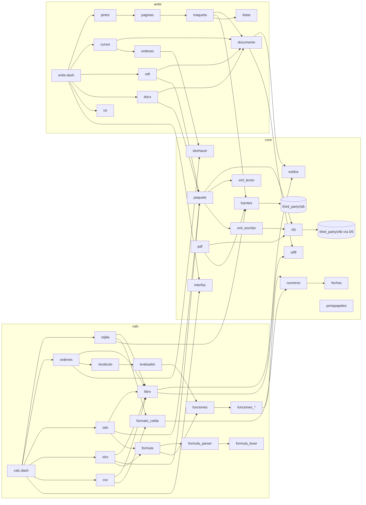

# 07. Módulos e interfaces

**Interfaz propuesta, escrita antes del código** (2026-10-24). Dice qué hace cada módulo, de qué depende y qué
funciones públicas tendrá, con su firma en Dash. Sirve para repartir el trabajo y para que los módulos casen.

Cuando haya código, este documento se **generará del código**, como en Tachyon
(`docs/ingenieria/herramientas/gen_modulos.py`: la cabecera de cada fichero y el comentario de cada función pública).
Desde ese momento manda el código, no esta propuesta.

Los tipos son los de Dash: `Int`, `String`, `Bool`, `[T]` (lista), `{String: T}` (diccionario) y los structs de
[05](05_MODELO_DE_DATOS.md). `Double` (D1), `[Double]` (D2) y `{Int: T}` (D9) llegan con sus tareas de
[13](13_DASH.md). Un `Int` que es un puntero de C (un búfer, una imagen) se dice en la descripción.

## 1. Convenciones

- **Un prefijo por módulo** en todas sus funciones públicas (`zip_`, `xml_`, `libro_`...). En Dash todas las funciones
  públicas comparten un único espacio de nombres en C.
- **Las privadas llevan `_` y también el prefijo** (`_zip_leer_cabecera`). Dash avisa de que dos módulos con una
  privada del mismo nombre chocan en C (`AGENTS.md` de Dash, "Problemas conocidos").
- **Prefijos que no se usan**, porque ya son de Dash o lo serán: `fx_` (Fixed), `utf8_` (D5), `str_`, `file_`,
  `buffer_`, `mui_`, `gfx_`, `font_`, `clip_` (D18), `locale_` (D19). El módulo provisional de UTF-8 usa `u8_` y se
  quita cuando llegue D5.
- **Errores:** una función que puede fallar devuelve `nil` o `-1` y deja el motivo en `<prefijo>_error()` (un texto
  del catálogo). No hay excepciones en Dash.
- **Búferes:** quien llama a una función que devuelve un búfer lo libera con `buffer_free`, salvo que la descripción
  diga otra cosa.

## 2. Resumen

| Grupo | Módulo | Prefijo | Responsabilidad | Hito |
|---|---|---|---|---|
| Base | `core/zip.dash` | `zip_` | Leer y escribir ficheros ZIP | H1 |
| Base | `core/xml_lector.dash` | `xml_` | Lector XML por eventos | H1 |
| Base | `core/xml_escritor.dash` | `xe_` | Escritor XML a búfer y a ZIP | H1 |
| Base | `core/paquete.dash` | `paq_` | Detectar el formato; manifiesto ODF, tipos y relaciones OOXML; pérdidas | H1 |
| Base | `core/utf8.dash` | `u8_` | UTF-8 hasta que esté D5 | H1 |
| Base | `core/numeros.dash` | `num_` | `Double` ↔ texto; formatos de número | H2 |
| Base | `core/fechas.dash` | `fecha_` | Números de serie de fecha y hora | H2 |
| Base | `core/estilos.dash` | `est_` | Tabla de estilos deduplicada | H2 |
| Base | `core/deshacer.dash` | `dh_` | Pila de órdenes | H3 |
| Base | `core/fuentes.dash` | `fuente_` | Fuentes del Amiga y TrueType, medidas en twips | H2 / H8 |
| Base | `core/portapapeles.dash` | `pp_` | Copiar y pegar | H5 |
| Base | `core/pdf.dash` | `pdf_` | Escribir PDF | H9 |
| Base | `core/interfaz.dash` | `ui_` | Piezas MUI comunes | H2 |
| Calc | `calc/calc.dash` | — | El programa: ventanas, menús, bucle de eventos | H2 |
| Calc | `calc/libro.dash` | `libro_`, `hoja_`, `celda_` | El modelo del libro | H2 |
| Calc | `calc/formula_lexer.dash` | `flex_` | Texto de fórmula a fichas | H3 |
| Calc | `calc/formula_parser.dash` | `fpar_` | Fichas a código de pila | H3 |
| Calc | `calc/formula.dash` | `form_` | Compilar y escribir fórmulas en los tres dialectos; mover referencias | H3 |
| Calc | `calc/evaluador.dash` | `eval_` | Ejecutar el código de una fórmula | H3 |
| Calc | `calc/recalculo.dash` | `recalc_` | Grafo de dependencias, sucias, círculos | H3 |
| Calc | `calc/funciones.dash` | `funcs_` | Tabla de funciones: nombres, ids, número de argumentos | H3 |
| Calc | `calc/funciones_*.dash` | `fmat_`, `fest_`, `ftex_`, `ffec_`, `flog_`, `fbus_`, `finf_`, `ffin_` | Las funciones de cada grupo | H3 / H5 |
| Calc | `calc/formato_celda.dash` | `fc_` | Texto que se ve en una celda; reconocer lo que se escribe | H2 / H3 |
| Calc | `calc/rejilla.dash` | `rej_` | Pintar la hoja y traducir clics a celdas | H2 |
| Calc | `calc/ordenes.dash` | `cord_` | Órdenes de edición de Calc (hacer y deshacer) | H3 |
| Calc | `calc/ods.dash` | `ods_` | Leer y escribir `.ods` y `.fods` | H2 / H3 |
| Calc | `calc/xlsx.dash` | `xlsx_` | Leer y escribir `.xlsx` | H2 / H4 |
| Calc | `calc/csv.dash` | `csv_` | Leer y escribir `.csv` | H2 / H4 |
| Write | `write/write.dash` | — | El programa | H6 |
| Write | `write/documento.dash` | `doc_`, `par_` | El modelo del documento; formato efectivo | H6 |
| Write | `write/listas.dash` | `listas_` | Números y viñetas de las listas | H8 |
| Write | `write/maqueta.dash` | `maq_` | Partir párrafos en líneas | H6 |
| Write | `write/paginas.dash` | `pag_` | Repartir bloques en páginas | H6 |
| Write | `write/pintor.dash` | `pint_` | Pintar páginas | H6 |
| Write | `write/cursor.dash` | `cur_` | Cursor, selección, movimientos | H7 |
| Write | `write/ordenes.dash` | `word_` | Órdenes de edición de Write | H7 |
| Write | `write/odt.dash` | `odt_` | Leer y escribir `.odt` y `.fodt` | H6 / H7 |
| Write | `write/docx.dash` | `docx_` | Leer y escribir `.docx` | H6 / H7 |
| Write | `write/txt.dash` | `txt_` | Leer y escribir `.txt` | H6 / H7 |

Respecto a [ARQUITECTURA](../ARQUITECTURA.md) se añaden `calc/funciones.dash` (la tabla), `calc/formato_celda.dash`,
`calc/ordenes.dash`, `write/listas.dash` y `write/ordenes.dash`. Las pérdidas van en `core/paquete`.

## 3. Dependencias

`calc` y `write` dependen de `core`; nunca al revés ni entre ellos (arquitectura § 2).

## 4. Base común (`core/`)

### `core/zip.dash`

Lee el directorio central de un ZIP y saca entradas a búferes. Escribe ZIP con entradas guardadas o comprimidas.
Depende de D6 (`inflate`, `deflate`, `crc32`). No admite ZIP64 ni cifrado de ZIP (se avisa).

| Firma | Qué hace |
|---|---|
| `zip_abrir(ruta: String) -> Zip` | Abre un ZIP y lee su directorio central. `nil` si no es un ZIP válido. |
| `zip_cerrar(z: Zip)` | Cierra el fichero. |
| `zip_entradas(z: Zip) -> [String]` | Nombres de las entradas, en orden. |
| `zip_existe(z: Zip, nombre: String) -> Bool` | Si hay una entrada con ese nombre. |
| `zip_tamano(z: Zip, nombre: String) -> Int` | Tamaño descomprimido; `-1` si no está. |
| `zip_leer(z: Zip, nombre: String) -> Int` | La entrada descomprimida en un búfer nuevo (C); `0` si falla (CRC, memoria). |
| `zip_crear(ruta: String) -> ZipSalida` | Empieza un ZIP nuevo. |
| `zip_poner(zs: ZipSalida, nombre: String, buf: Int, n: Int, comprimir: Bool) -> Bool` | Añade una entrada desde un búfer. |
| `zip_poner_texto(zs: ZipSalida, nombre: String, texto: String, comprimir: Bool) -> Bool` | Añade una entrada desde un texto. |
| `zip_terminar(zs: ZipSalida) -> Bool` | Escribe el directorio central y cierra. |
| `zip_error() -> String` | Motivo del último fallo. |

### `core/xml_lector.dash`

Lector XML por eventos sobre un búfer. No construye árbol. Resuelve los espacios de nombres: cada URI conocida se
traduce a un prefijo fijo de Lorraine (`office`, `table`, `text`, `style`, `fo`, `number`, `w`, `x`, `r`, `a`, `wp`,
`pic`...), sea cual sea el prefijo del fichero. Así se leen también las URIs de OOXML Strict ([12](12_FORMATOS.md)
§ 3.1). Decodifica entidades y referencias numéricas a UTF-8. Si el texto declara otra codificación que UTF-8 o
UTF-16, da error.

| Firma | Qué hace |
|---|---|
| `xml_abrir(buf: Int, n: Int) -> Xml` | Prepara la lectura de un búfer (no lo copia ni lo libera). |
| `xml_siguiente(x: Xml) -> Int` | Avanza: `X_INICIO`, `X_FIN`, `X_TEXTO`, `X_FIN_DOC` o `X_ERROR`. |
| `xml_nombre(x: Xml) -> String` | Nombre del elemento actual con el prefijo fijo (`"table:table-cell"`). |
| `xml_atributo(x: Xml, nombre: String) -> String` | Valor de un atributo del elemento actual (prefijo fijo); `nil` si no está. |
| `xml_atributo_int(x: Xml, nombre: String, defecto: Int) -> Int` | Lo mismo, como entero. |
| `xml_texto(x: Xml) -> String` | El texto del evento `X_TEXTO`. |
| `xml_vacio(x: Xml) -> Bool` | Si el elemento actual es `<x/>` (llegará su `X_FIN` igual). |
| `xml_profundidad(x: Xml) -> Int` | Nivel del elemento actual. |
| `xml_saltar(x: Xml)` | Salta el elemento actual con todo su contenido (lo que no se entiende). |
| `xml_texto_todo(x: Xml) -> String` | Junta todo el texto hasta el fin del elemento actual. |
| `xml_linea(x: Xml) -> Int` | Línea actual, para los mensajes de error. |
| `xml_error() -> String` | Motivo del último error. |

### `core/xml_escritor.dash`

Escribe XML a un búfer que crece. Escapa `&`, `<`, `>`, `"` y los caracteres de control.

| Firma | Qué hace |
|---|---|
| `xe_nuevo(capacidad: Int) -> XmlSalida` | Escritor nuevo. |
| `xe_declaracion(e: XmlSalida)` | `<?xml version="1.0" encoding="UTF-8" standalone="yes"?>` |
| `xe_abrir(e: XmlSalida, nombre: String)` | Abre un elemento; los atributos van después. |
| `xe_atr(e: XmlSalida, nombre: String, valor: String)` | Atributo del elemento recién abierto. |
| `xe_atr_int(e: XmlSalida, nombre: String, valor: Int)` | Atributo entero. |
| `xe_atr_double(e: XmlSalida, nombre: String, valor: Double)` | Atributo numérico con el número más corto (D3). |
| `xe_texto(e: XmlSalida, texto: String)` | Texto escapado. |
| `xe_cerrar(e: XmlSalida)` | Cierra el último elemento abierto (`/>` si no tuvo contenido). |
| `xe_crudo(e: XmlSalida, s: String)` | Escribe tal cual (espacios de nombres de la raíz). |
| `xe_a_zip(e: XmlSalida, zs: ZipSalida, nombre: String) -> Bool` | Vuelca lo escrito como entrada del ZIP y lo suelta. |
| `xe_a_fichero(e: XmlSalida, ruta: String) -> Bool` | Vuelca a un fichero (Flat ODF). |
| `xe_liberar(e: XmlSalida)` | Suelta el búfer. |

**Comprobar en H1** (13 § 3) si hace falta escribir al ZIP por trozos para no tener un `content.xml` de varios MB
entero en memoria.

### `core/paquete.dash`

Lo común de los paquetes ODF y OOXML, y las pérdidas.

| Firma | Qué hace |
|---|---|
| `paq_detectar(ruta: String) -> Int` | Formato por el contenido (RF-N02): `FMT_ODS`, `FMT_FODS`, `FMT_XLSX`, `FMT_CSV`, `FMT_ODT`, `FMT_FODT`, `FMT_DOCX`, `FMT_TXT`, `FMT_CIFRADO`, `FMT_OFFICE_ANTIGUO`, `FMT_DESCONOCIDO`. |
| `paq_odf_mimetype(z: Zip) -> String` | El contenido de `mimetype`. |
| `paq_odf_cifrado(z: Zip) -> Bool` | Si el manifiesto tiene `manifest:encryption-data` ([12](12_FORMATOS.md) § 7). |
| `paq_odf_manifiesto(zs: ZipSalida, tipo: String, entradas: [String], tipos: [String]) -> Bool` | Escribe `mimetype` (el primero, sin comprimir) y `META-INF/manifest.xml`. |
| `paq_ooxml_principal(z: Zip) -> String` | Ruta de la parte principal según `_rels/.rels`. |
| `paq_ooxml_rels(z: Zip, parte: String) -> {String: String}` | Relaciones de una parte: id → ruta ya resuelta. |
| `paq_ooxml_rels_tipos(z: Zip, parte: String) -> {String: String}` | Relaciones de una parte: id → tipo de relación. |
| `paq_ooxml_tipo(z: Zip, parte: String) -> String` | Tipo de contenido de una parte según `[Content_Types].xml`. |
| `paq_ooxml_escribir_tipos(zs: ZipSalida, partes: [String], tipos: [String]) -> Bool` | Escribe `[Content_Types].xml`. |
| `paq_ooxml_escribir_rels(zs: ZipSalida, parte: String, ids: [String], tipos: [String], destinos: [String]) -> Bool` | Escribe el `.rels` de una parte. |
| `paq_guardar_seguro(ruta: String) -> String` | Nombre del temporal en el mismo volumen (RF-N05). |
| `paq_cambiar(temporal: String, ruta: String) -> Bool` | Cambia el temporal por el original al acabar bien. |
| `perdidas_nuevas() -> Perdidas` | Lista vacía. |
| `perdida(p: Perdidas, codigo: String)` | Apunta una pérdida (una vez por código, contando las veces). |
| `perdidas_texto(p: Perdidas) -> String` | El aviso para el usuario, con los textos del catálogo. |
| `paq_base64(texto: String) -> Int` | Decodifica base64 a un búfer (imágenes de Flat ODF). |

### `core/utf8.dash` (provisional, hasta D5)

| Firma | Qué hace |
|---|---|
| `u8_siguiente(s: String, i: Int) -> Int` | Byte donde empieza el carácter siguiente. |
| `u8_anterior(s: String, i: Int) -> Int` | Byte donde empieza el carácter anterior. |
| `u8_codigo(s: String, i: Int) -> Int` | Punto de código del carácter en el byte `i`. |
| `u8_caracter(cp: Int) -> String` | Texto UTF-8 de un punto de código. |
| `u8_largo(s: String) -> Int` | Número de caracteres. |
| `u8_a_latin1(s: String) -> String` | Para pintar con fuentes del Amiga; lo que no existe, por algo parecido o `?`. |
| `u8_de_latin1(s: String) -> String` | De Latin-1 (portapapeles, `.txt` antiguos) a UTF-8. |
| `u8_valido(s: String) -> Bool` | Si es UTF-8 bien formado (detectar la codificación de `.txt` y `.csv`). |
| `u8_mayusculas(s: String) -> String` | Mayúsculas (Latin-1 extendido como mínimo; el resto sin cambiar). |
| `u8_minusculas(s: String) -> String` | Minúsculas. |

### `core/numeros.dash`

| Firma | Qué hace |
|---|---|
| `num_a_texto(d: Double) -> String` | El texto más corto que vuelve al mismo número, con punto (para ficheros). Usa D3. |
| `num_de_texto(s: String) -> Double` | Lee un número con punto (de ficheros). |
| `num_valido(s: String) -> Bool` | Si el texto era un número entero válido para `num_de_texto`. |
| `num_formato(codigo: String) -> Int` | Lee un código de formato (`#,##0.00;[Red]-#,##0.00`) y devuelve su número en la tabla de formatos leídos. |
| `num_formato_codigo(f: Int) -> String` | El código de un formato leído (para guardar). |
| `num_formatear(d: Double, f: Int, fecha1904: Bool) -> String` | El texto que se ve, con los separadores del idioma (D19). |
| `num_formatear_color(d: Double, f: Int) -> Int` | El color que pide el formato (`[Red]`), o `-1`. |
| `num_es_fecha(f: Int) -> Bool` | Si el formato es de fecha u hora (para saber qué es una celda). |
| `num_leer_usuario(s: String) -> Double` | Lee un número escrito por el usuario en su idioma (`1.234,5`, `25%`). Deja en `num_ultimo_formato()` el formato que sugiere. |
| `num_ultimo_formato() -> Int` | El formato sugerido por la última lectura. |
| `num_decimal() -> String` | Separador decimal del idioma (D19). |
| `num_miles() -> String` | Separador de miles del idioma (D19). |

### `core/fechas.dash`

| Firma | Qué hace |
|---|---|
| `fecha_serie(anio: Int, mes: Int, dia: Int, f1904: Bool) -> Double` | Número de serie de una fecha. |
| `fecha_desde_serie(d: Double, f1904: Bool) -> [Int]` | `[año, mes, día, hora, minuto, segundo, día de la semana]`. |
| `fecha_hora_serie(h: Int, m: Int, s: Int) -> Double` | Fracción de día. |
| `fecha_iso(d: Double, f1904: Bool) -> String` | `2026-10-24T13:05:00` (ODF `office:date-value`). |
| `fecha_de_iso(s: String, f1904: Bool) -> Double` | De ISO 8601 a serie. |
| `fecha_duracion_iso(d: Double) -> String` | `PT13H05M00S` (ODF `office:time-value`). |
| `fecha_de_duracion_iso(s: String) -> Double` | De duración ISO a fracción de día. |
| `fecha_ahora() -> Double` | Ahora como número de serie (D20). |
| `fecha_leer_usuario(s: String) -> Double` | Lee una fecha escrita en el orden del idioma (D19); `-1` si no lo es. |

### `core/estilos.dash`

Tabla genérica que guarda cada estilo una vez, por su clave de texto. Calc la usa para `EstiloCelda` y Write para
el formato directo de carácter.

| Firma | Qué hace |
|---|---|
| `est_tabla() -> TablaEstilos` | Tabla vacía. |
| `est_numero(t: TablaEstilos, clave: String) -> Int` | Número del estilo con esa clave; `-1` si no está. |
| `est_anadir(t: TablaEstilos, clave: String) -> Int` | Añade la clave si no está y devuelve su número. |
| `est_cuantos(t: TablaEstilos) -> Int` | Cuántos hay. |
| `est_color_texto(c: Int) -> String` | `0xRRGGBB` a `#rrggbb` (ODF) o `RRGGBB` (OOXML) según el formato pedido. |
| `est_color_de_texto(s: String) -> Int` | De `#rrggbb`, `RRGGBB` o `FFRRGGBB` (ARGB de OOXML) a `0xRRGGBB`. |

### `core/deshacer.dash`

Solo la pila. Hacer y deshacer cada tipo de orden es cosa de `calc/ordenes` y `write/ordenes`.

| Firma | Qué hace |
|---|---|
| `dh_nueva(maximo: Int) -> Deshacer` | Pila vacía. |
| `dh_apuntar(d: Deshacer, o: Orden)` | Apunta una orden ya hecha; vacía las deshechas. |
| `dh_puede_deshacer(d: Deshacer) -> Bool` | |
| `dh_puede_rehacer(d: Deshacer) -> Bool` | |
| `dh_sacar_deshacer(d: Deshacer) -> [Orden]` | Las órdenes del último grupo, para deshacerlas en orden inverso. |
| `dh_sacar_rehacer(d: Deshacer) -> [Orden]` | Las del siguiente grupo a rehacer. |
| `dh_nuevo_grupo(d: Deshacer) -> Int` | Número para agrupar varias órdenes. |
| `dh_vaciar(d: Deshacer)` | Vacía todo (al abrir otro documento en la ventana). |

### `core/fuentes.dash`

Fuentes del Amiga (por `diskfont.library`) con una tabla de sustitución, y TrueType desde H8 (D23). Las medidas se
dan en twips para la maqueta y en píxeles para pintar.

| Firma | Qué hace |
|---|---|
| `fuente_pedir(nombre: String, tamano: Int, negrita: Bool, cursiva: Bool, ppp: Int) -> Int` | Fuente para pintar a `ppp` puntos por pulgada (C). Sustituye el nombre si no existe. Guarda en caché. |
| `fuente_sustituta(nombre: String) -> String` | Qué fuente del Amiga se usa para un nombre del documento. |
| `fuente_ancho_tw(f: Int, texto: String) -> Int` | Ancho de un texto UTF-8 en twips. |
| `fuente_alto_tw(f: Int) -> Int` | Alto de línea en twips. |
| `fuente_base_tw(f: Int) -> Int` | Distancia de arriba a la línea base. |
| `fuente_usar(f: Int)` | La pone para pintar (`font_use`). |
| `fuente_liberar_todas()` | Suelta la caché (al salir o si falta memoria). |

### `core/portapapeles.dash`

| Firma | Qué hace |
|---|---|
| `pp_poner_texto(s: String) -> Bool` | Copia texto (UTF-8 → Latin-1 para FTXT). Usa D18. |
| `pp_leer_texto() -> String` | Texto del portapapeles en UTF-8; `nil` si no hay texto. |
| `pp_poner_propio(tipo: String, buf: Int, n: Int) -> Bool` | Bloque con un identificador IFF de Lorraine (celdas con formato, texto con tramos). |
| `pp_leer_propio(tipo: String) -> Int` | El bloque propio, si es lo último copiado; `0` si no. |

### `core/pdf.dash` (H9)

| Firma | Qué hace |
|---|---|
| `pdf_nuevo(ruta: String) -> Pdf` | Empieza un PDF. |
| `pdf_pagina(p: Pdf, ancho_tw: Int, alto_tw: Int)` | Página nueva. |
| `pdf_texto(p: Pdf, x: Int, y: Int, texto: String, fuente: String, tamano: Int, color: Int)` | Texto en twips con una de las 14 fuentes estándar. |
| `pdf_linea(p: Pdf, x1: Int, y1: Int, x2: Int, y2: Int, grosor: Int, color: Int)` | Línea. |
| `pdf_rectangulo(p: Pdf, x: Int, y: Int, ancho: Int, alto: Int, relleno: Int)` | Rectángulo relleno. |
| `pdf_imagen(p: Pdf, x: Int, y: Int, ancho: Int, alto: Int, img: Imagen)` | Imagen (JPEG tal cual; el resto, decodificada). |
| `pdf_terminar(p: Pdf) -> Bool` | Tabla de referencias y cierre. |

### `core/interfaz.dash`

| Firma | Qué hace |
|---|---|
| `ui_abrir_fichero(titulo: String, patron: String) -> String` | Diálogo de abrir; `nil` si se cancela. |
| `ui_guardar_fichero(titulo: String, patron: String, nombre: String) -> String` | Diálogo de guardar. |
| `ui_elegir_formato(opciones: [String], actual: Int) -> Int` | Pide el formato al guardar; `-1` si se cancela. |
| `ui_aviso(texto: String)` | Aviso con un botón. |
| `ui_preguntar(texto: String, botones: String) -> Int` | Pregunta (`"Guardar\|No guardar\|Cancelar"`); devuelve el botón. |
| `ui_acerca_de(programa: String, version: String)` | Ventana Acerca de. |
| `ui_recientes_leer(programa: String) -> [String]` | Documentos recientes (RF-N11), de `ENVARC:Lorraine/`. |
| `ui_recientes_apuntar(programa: String, ruta: String)` | Apunta uno. |

## 5. Lorraine Calc (`calc/`)

### `calc/calc.dash`

El programa. Abre la aplicación MUI, una ventana por libro (`calc.dashui`), los menús, y lleva el bucle de eventos.
No tiene funciones públicas.

### `calc/libro.dash`

| Firma | Qué hace |
|---|---|
| `libro_nuevo() -> Libro` | Libro vacío con una hoja. |
| `libro_hoja(l: Libro, i: Int) -> Hoja` | Hoja por número. |
| `libro_buscar_hoja(l: Libro, nombre: String) -> Int` | Número de una hoja por nombre; `-1`. |
| `libro_anadir_hoja(l: Libro, nombre: String, pos: Int) -> Hoja` | Inserta una hoja. |
| `libro_quitar_hoja(l: Libro, i: Int) -> Hoja` | La quita y la devuelve (para deshacer). |
| `libro_texto(l: Libro, i: Int) -> String` | Texto compartido número `i`. |
| `libro_texto_numero(l: Libro, s: String) -> Int` | Número de un texto, añadiéndolo si no está. |
| `libro_modificado(l: Libro) -> Bool` | Si hay cambios sin guardar. |
| `hoja_celda(h: Hoja, f: Int, c: Int) -> Celda` | La celda, o `nil` si está vacía. |
| `hoja_celda_crear(h: Hoja, f: Int, c: Int) -> Celda` | La celda, creándola si hace falta. |
| `hoja_ultima_fila(h: Hoja) -> Int` | Última fila con algo. |
| `hoja_ultima_col(h: Hoja) -> Int` | Última columna con algo. |
| `hoja_ancho(h: Hoja, c: Int) -> Int` | Ancho de una columna en twips (0 si está oculta). |
| `hoja_alto(h: Hoja, f: Int) -> Int` | Alto de una fila en twips. |
| `hoja_poner_ancho(h: Hoja, c: Int, tw: Int)` | |
| `hoja_poner_alto(h: Hoja, f: Int, tw: Int)` | |
| `hoja_combinada(h: Hoja, f: Int, c: Int) -> Rango` | El rango combinado que contiene la celda, o `nil`. |
| `celda_tipo(c: Celda) -> Int` | `T_VACIA`, `T_NUMERO`, `T_TEXTO`, `T_LOGICO`, `T_ERROR`. |
| `celda_estilo(c: Celda) -> Int` | Número de estilo. |
| `celda_poner_numero(c: Celda, d: Double)` | Pone un número (sin deshacer ni recálculo: eso es `calc/ordenes`). |
| `celda_poner_texto(l: Libro, c: Celda, s: String)` | Pone un texto. |
| `celda_poner_logico(c: Celda, v: Bool)` | |
| `celda_poner_error(c: Celda, e: Int)` | |
| `celda_poner_estilo(c: Celda, e: Int)` | |
| `libro_dump(l: Libro) -> String` | Volcado de valores en el formato de `tools/volcar_lo.py`, para los tests. |

### `calc/formula_lexer.dash` y `calc/formula_parser.dash`

| Firma | Qué hace |
|---|---|
| `flex_fichas(texto: String, dialecto: Int) -> [Ficha]` | Parte el texto en fichas. `dialecto`: `D_USUARIO` (idioma y separador del usuario), `D_ODF` (OpenFormula), `D_OOXML`. |
| `fpar_compilar(fichas: [Ficha], fila: Int, col: Int, l: Libro) -> Formula` | Fichas a código de pila, con las referencias relativas a la celda (`fila`, `col`). `nil` si hay error de sintaxis; posición en `fpar_error_pos()`. |
| `fpar_error() -> String` | Motivo del error de sintaxis. |
| `fpar_error_pos() -> Int` | Byte del texto donde está. |

### `calc/formula.dash`

| Firma | Qué hace |
|---|---|
| `form_compilar(texto: String, dialecto: Int, l: Libro, h: Int, f: Int, c: Int) -> Formula` | Texto a fórmula, compartiendo la `Formula` si ya existe una igual (por su `clave`). |
| `form_texto(fo: Formula, dialecto: Int, l: Libro, h: Int, f: Int, c: Int) -> String` | Fórmula a texto en un dialecto, para la celda (`h`, `f`, `c`). |
| `form_mover(fo: Formula, df: Int, dc: Int) -> Formula` | La fórmula que resulta al copiar una celda `df` filas y `dc` columnas (las relativas no cambian; las absolutas tampoco: solo cambia la `clave` si hay absolutas mixtas). |
| `form_insertar(fo: Formula, h: Int, f: Int, c: Int, desde: Int, cuantas: Int, son_filas: Bool) -> Formula` | Ajusta las referencias al insertar o borrar filas o columnas (RF-C16); las que apuntan a lo borrado pasan a `#REF!`. |
| `form_refs(fo: Formula, f: Int, c: Int) -> [Rango]` | Lo que lee, ya absoluto, para el grafo. |

### `calc/evaluador.dash`

| Firma | Qué hace |
|---|---|
| `eval_formula(l: Libro, ca: Calculo) -> Valor` | Ejecuta el código y devuelve el resultado. Puede pedir el cálculo de celdas sucias que lea. |
| `eval_numero(l: Libro, v: Valor) -> Double` | Convierte un valor a número según las reglas de Excel y LibreOffice (texto → `#VALUE!`, vacío → 0). |
| `eval_texto(l: Libro, v: Valor) -> String` | Convierte un valor a texto. |
| `eval_recorrer(l: Libro, v: Valor, f: Func)` | Llama a `f` con cada celda de un rango (para SUMA y compañía), sin crear listas. |

### `calc/recalculo.dash`

| Firma | Qué hace |
|---|---|
| `recalc_registrar(l: Libro, ca: Calculo)` | Apunta en el grafo lo que lee una fórmula nueva. |
| `recalc_olvidar(l: Libro, ca: Calculo)` | Lo quita del grafo. |
| `recalc_cambio(l: Libro, h: Int, f: Int, c: Int)` | Marca sucio lo que depende de una celda. |
| `recalc_cambio_rango(l: Libro, r: Rango)` | Lo mismo para un rango (pegar, borrar, ordenar). |
| `recalc_ejecutar(l: Libro) -> Int` | Calcula todo lo sucio y las volátiles; devuelve cuántas fórmulas calculó (para RF-C09). |
| `recalc_todo(l: Libro)` | Marca todo sucio y recalcula (orden Recalcular todo). |

### `calc/funciones.dash` y `calc/funciones_*.dash`

`funciones.dash` tiene la tabla: nombre inglés, nombre de cada idioma (del catálogo), nombre en ODF (con su prefijo
si lo lleva, [12](12_FORMATOS.md) § 2.6), en OOXML (con `_xlfn.` si lo lleva), argumentos mínimos y máximos,
volátil sí o no, y la función que la calcula.

| Firma | Qué hace |
|---|---|
| `funcs_buscar(nombre: String, dialecto: Int) -> Int` | Id de una función por su nombre en un dialecto; `F_DESCONOCIDA` si no está. |
| `funcs_nombre(id: Int, dialecto: Int) -> String` | Nombre de una función en un dialecto. |
| `funcs_args(id: Int) -> [Int]` | `[mínimo, máximo]` (máximo `-1`: sin límite). |
| `funcs_volatil(id: Int) -> Bool` | |
| `funcs_llamar(id: Int, l: Libro, pila: [Valor], n: Int) -> Valor` | Calcula con los `n` argumentos de arriba de la pila. |

Cada `funciones_<grupo>.dash` tiene una función pública de registro (`fmat_registrar()`, `fest_registrar()`...) y las
funciones de la hoja como privadas con su prefijo (`_fmat_suma`). Grupos: `mat`, `est`, `texto` (`ftex_`), `fecha`
(`ffec_`), `logica` (`flog_`), `busqueda` (`fbus_`), `info` (`finf_`), `fin` (`ffin_`). La lista de funciones de cada
hito está en [01](01_REQUISITOS.md) § 3.3.

### `calc/formato_celda.dash`

| Firma | Qué hace |
|---|---|
| `fc_texto(l: Libro, c: Celda) -> String` | Lo que se ve en la celda (número formateado, texto, `VERDADERO`, error). |
| `fc_color(l: Libro, c: Celda) -> Int` | Color del texto (el del estilo o el del formato de número). |
| `fc_alineacion(l: Libro, c: Celda) -> Int` | Alineación efectiva (General: números a la derecha, textos a la izquierda). |
| `fc_entrada(l: Libro, s: String) -> Valor` | Reconoce lo que escribe el usuario: número, porcentaje, fecha, lógico, texto o fórmula (RF-C06). |
| `fc_formato_sugerido() -> Int` | El formato que sugiere la última entrada (una fecha pone formato de fecha). |

### `calc/rejilla.dash`

Pinta la hoja en el lienzo MUI y traduce el ratón a celdas. No toca el modelo.

| Firma | Qué hace |
|---|---|
| `rej_nueva(lienzo: Int, l: Libro) -> Rejilla` | Rejilla sobre un lienzo MUI. |
| `rej_pintar(r: Rejilla, x: Int, y: Int, ancho: Int, alto: Int)` | La función de dibujo del lienzo (`mui_canvas_on_draw`). |
| `rej_hoja(r: Rejilla, i: Int)` | Cambia la hoja que se ve. |
| `rej_ir(r: Rejilla, f: Int, c: Int)` | Mueve la celda activa y desplaza si hace falta. |
| `rej_seleccion(r: Rejilla) -> Rango` | La selección actual. |
| `rej_seleccionar(r: Rejilla, s: Rango)` | |
| `rej_celda_en(r: Rejilla, x: Int, y: Int) -> [Int]` | `[fila, col]` bajo un punto; `-1` en cabeceras. |
| `rej_borde_columna_en(r: Rejilla, x: Int, y: Int) -> Int` | Columna cuyo borde está bajo el punto (para cambiar el ancho); `-1`. |
| `rej_repintar_celda(r: Rejilla, f: Int, c: Int)` | Repinta solo ese rectángulo (`mui_canvas_update_area`). |
| `rej_repintar_rango(r: Rejilla, s: Rango)` | |
| `rej_desplazar(r: Rejilla, primera_fila: Int, primera_col: Int)` | |
| `rej_zoom(r: Rejilla, porcentaje: Int)` | |

### `calc/ordenes.dash`

Cada cambio del usuario pasa por aquí: lo hace, lo apunta para deshacer y avisa al recálculo.

| Firma | Qué hace |
|---|---|
| `cord_escribir(l: Libro, h: Int, f: Int, c: Int, entrada: String) -> Bool` | Escribe lo que tecleó el usuario (número, texto o fórmula). `false` con error de fórmula. |
| `cord_borrar(l: Libro, s: Rango)` | Borra contenidos. |
| `cord_estilo(l: Libro, s: Rango, cambio: EstiloCelda)` | Aplica un cambio de formato (solo los campos puestos). |
| `cord_insertar(l: Libro, h: Int, desde: Int, cuantas: Int, son_filas: Bool)` | Inserta filas o columnas. |
| `cord_quitar(l: Libro, h: Int, desde: Int, cuantas: Int, son_filas: Bool)` | Las borra. |
| `cord_pegar(l: Libro, destino: Rango, origen: [Celda], filas: Int, cols: Int)` | Pega celdas copiadas, moviendo sus fórmulas. |
| `cord_rellenar(l: Libro, s: Rango, hacia: Int)` | Rellenar abajo, derecha o serie (RF-C17). |
| `cord_ordenar(l: Libro, s: Rango, claves: [Int], ascendente: [Bool])` | RF-C18. |
| `cord_ancho(l: Libro, h: Int, c: Int, tw: Int)` | |
| `cord_alto(l: Libro, h: Int, f: Int, tw: Int)` | |
| `cord_combinar(l: Libro, s: Rango, combinar: Bool)` | |
| `cord_deshacer(l: Libro) -> Rango` | Deshace el último grupo; devuelve lo que hay que repintar. |
| `cord_rehacer(l: Libro) -> Rango` | |

### `calc/ods.dash`, `calc/xlsx.dash`, `calc/csv.dash`

| Firma | Qué hace |
|---|---|
| `ods_leer(ruta: String, plano: Bool) -> Libro` | Lee `.ods` (o `.fods` con `plano`). `nil` si falla; motivo en `ods_error()`. |
| `ods_escribir(l: Libro, ruta: String, plano: Bool) -> Bool` | Escribe `.ods` o `.fods` (por el guardado seguro). |
| `xlsx_leer(ruta: String) -> Libro` | |
| `xlsx_escribir(l: Libro, ruta: String) -> Bool` | |
| `csv_leer(ruta: String, opciones: OpcionesCsv) -> Libro` | Separador, comillas y codificación; con `opciones` a `nil`, los adivina. |
| `csv_escribir(l: Libro, h: Int, ruta: String, opciones: OpcionesCsv) -> Bool` | Una hoja. |
| `ods_error() -> String`, `xlsx_error() -> String`, `csv_error() -> String` | Motivo del último fallo. |

## 6. Lorraine Write (`write/`)

### `write/write.dash`

El programa: aplicación MUI, una ventana por documento (`write.dashui`), menús, barra de formato, bucle de eventos.
Sin funciones públicas.

### `write/documento.dash`

| Firma | Qué hace |
|---|---|
| `doc_nuevo() -> Documento` | Documento vacío: una sección A4 y un párrafo vacío. |
| `doc_bloques(d: Documento) -> Int` | Número de bloques del cuerpo. |
| `doc_parrafo(d: Documento, i: Int) -> Parrafo` | El párrafo del bloque `i`, o `nil` si es una tabla. |
| `doc_seccion_de(d: Documento, bloque: Int) -> Seccion` | La sección de un bloque. |
| `doc_estilo_p(d: Documento, nombre: String) -> Int` | Número de un estilo de párrafo por nombre; `-1`. |
| `doc_estilo_c(d: Documento, nombre: String) -> Int` | Lo mismo para carácter. |
| `doc_formato_c(d: Documento, e: EstiloCaracter) -> Int` | Número del formato directo igual a `e`, creándolo si no está. |
| `doc_efectivo_c(d: Documento, p: Parrafo, t: Tramo) -> EstiloCaracter` | Formato de carácter efectivo (05 § 4.4), de la caché. |
| `doc_efectivo_p(d: Documento, p: Parrafo) -> EstiloParrafo` | Formato de párrafo efectivo. |
| `doc_modificado(d: Documento) -> Bool` | |
| `doc_dump(d: Documento) -> String` | Volcado de texto y formato en el formato de `tools/volcar_lo.py`. |
| `par_nuevo(texto: String, estilo: Int) -> Parrafo` | Párrafo con un tramo que lo cubre todo. |
| `par_tramo_en(p: Parrafo, byte: Int) -> Int` | Tramo que contiene un byte. |
| `par_insertar(p: Parrafo, byte: Int, texto: String)` | Inserta texto heredando el formato del tramo; tira la caché. |
| `par_quitar(p: Parrafo, desde: Int, hasta: Int) -> String` | Quita texto y devuelve lo quitado; ajusta y funde tramos. |
| `par_partir(p: Parrafo, byte: Int) -> Parrafo` | Return: parte el párrafo y devuelve la segunda mitad. |
| `par_juntar(p: Parrafo, siguiente: Parrafo)` | Borrar al final de un párrafo. |
| `par_formato(p: Parrafo, desde: Int, hasta: Int, directo: Int)` | Pone un formato directo a un trozo, partiendo tramos. |

### `write/listas.dash`

| Firma | Qué hace |
|---|---|
| `listas_marca(d: Documento, bloque: Int) -> String` | El texto de la marca del párrafo ("3.", "b)", "•"), contando los anteriores de su lista y nivel. |
| `listas_recontar(d: Documento, desde: Int)` | Rehace la numeración desde un bloque. |

### `write/maqueta.dash` y `write/paginas.dash`

| Firma | Qué hace |
|---|---|
| `maq_parrafo(d: Documento, p: Parrafo, ancho: Int)` | Parte el párrafo en líneas para un ancho en twips; llena `p.lineas` y `p.alto`. |
| `maq_tabla(d: Documento, t: Tabla, ancho: Int) -> Int` | Maqueta una tabla; devuelve su alto. |
| `maq_posicion(d: Documento, p: Parrafo, byte: Int) -> [Int]` | `[x, y, alto]` del cursor en un byte, dentro del párrafo. |
| `maq_byte_en(d: Documento, p: Parrafo, x: Int, y: Int) -> Int` | Byte del párrafo bajo un punto. |
| `pag_repaginar(d: Documento, desde: Int) -> Int` | Reparte bloques en páginas desde un bloque; devuelve el número de páginas. |
| `pag_cuantas(d: Documento) -> Int` | |
| `pag_de_bloque(d: Documento, bloque: Int) -> Int` | Página donde empieza un bloque. |
| `pag_bloques(d: Documento, pagina: Int) -> [Int]` | `[primer bloque, primera línea, último bloque, última línea]` de una página. |

### `write/pintor.dash`

| Firma | Qué hace |
|---|---|
| `pint_nuevo(lienzo: Int, d: Documento) -> Pintor` | |
| `pint_pintar(pi: Pintor, x: Int, y: Int, ancho: Int, alto: Int)` | La función de dibujo del lienzo: las páginas visibles. |
| `pint_zoom(pi: Pintor, porcentaje: Int)` | 50-200 %, o `Z_PAGINA`, `Z_ANCHO` (RF-W04). |
| `pint_desplazar(pi: Pintor, y: Int)` | |
| `pint_repintar_parrafo(pi: Pintor, bloque: Int)` | Repinta solo lo de un párrafo. |
| `pint_a_documento(pi: Pintor, x: Int, y: Int) -> [Int]` | De píxeles del lienzo a `[página, x_tw, y_tw]`. |

### `write/cursor.dash`

| Firma | Qué hace |
|---|---|
| `cur_nuevo(d: Documento) -> Cursor` | Cursor al principio. |
| `cur_mover(cu: Cursor, como: Int, seleccionar: Bool)` | `M_CARACTER`, `M_PALABRA`, `M_LINEA`, `M_PARRAFO`, `M_PAGINA`, `M_INICIO`, `M_FIN`, con dirección en el signo (RF-W05). |
| `cur_clic(cu: Cursor, pi: Pintor, x: Int, y: Int, veces: Int, seleccionar: Bool)` | Clic, doble clic (palabra) o triple (párrafo). |
| `cur_arrastrar(cu: Cursor, pi: Pintor, x: Int, y: Int)` | Extiende la selección (D12). |
| `cur_seleccion(cu: Cursor) -> [Int]` | `[bloque inicio, byte inicio, bloque fin, byte fin]`. |
| `cur_texto_seleccion(cu: Cursor) -> String` | El texto seleccionado (copiar). |

### `write/ordenes.dash`

| Firma | Qué hace |
|---|---|
| `word_teclear(d: Documento, cu: Cursor, texto: String)` | Escribe donde está el cursor (sustituye la selección). |
| `word_borrar(d: Documento, cu: Cursor, adelante: Bool)` | Borrar y Supr. |
| `word_return(d: Documento, cu: Cursor)` | Párrafo nuevo con el estilo siguiente. |
| `word_formato_c(d: Documento, cu: Cursor, cambio: EstiloCaracter)` | Formato de carácter a la selección. |
| `word_formato_p(d: Documento, cu: Cursor, cambio: EstiloParrafo)` | Formato de párrafo a los párrafos seleccionados. |
| `word_estilo_p(d: Documento, cu: Cursor, estilo: Int)` | |
| `word_salto_pagina(d: Documento, cu: Cursor)` | |
| `word_pegar(d: Documento, cu: Cursor, bloques: [Bloque])` | |
| `word_reemplazar(d: Documento, buscar: String, poner: String, opciones: Int) -> Int` | Reemplaza todas; devuelve cuántas (RF-W09). |
| `word_deshacer(d: Documento, cu: Cursor) -> Int` | Deshace; devuelve el primer bloque a repaginar. |
| `word_rehacer(d: Documento, cu: Cursor) -> Int` | |

### `write/odt.dash`, `write/docx.dash`, `write/txt.dash`

| Firma | Qué hace |
|---|---|
| `odt_leer(ruta: String, plano: Bool) -> Documento` | `.odt` o `.fodt`. `nil` si falla; motivo en `odt_error()`. |
| `odt_escribir(d: Documento, ruta: String, plano: Bool) -> Bool` | |
| `docx_leer(ruta: String) -> Documento` | |
| `docx_escribir(d: Documento, ruta: String) -> Bool` | |
| `txt_leer(ruta: String) -> Documento` | Detecta UTF-8 o Latin-1; un párrafo por línea. |
| `txt_escribir(d: Documento, ruta: String, utf8: Bool) -> Bool` | RF-W03. |
| `odt_error() -> String`, `docx_error() -> String`, `txt_error() -> String` | |
