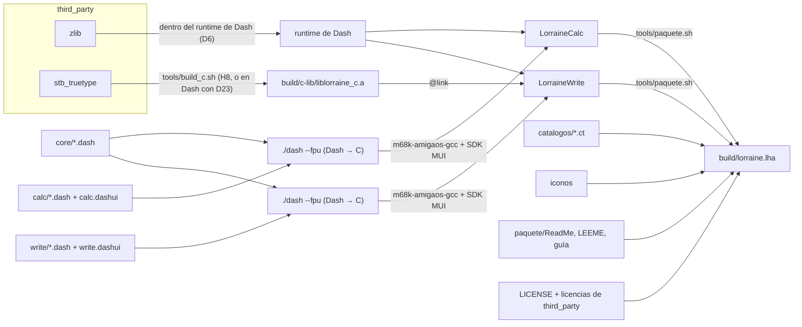

# 09. Entorno, construcción y entrega

Qué hace falta para compilar Lorraine, cómo se construye cada pieza, cómo se prueba en el emulador y cómo se hace y
publica el paquete para el Amiga. Es la **propuesta de partida**, copiada en lo posible del entorno que ya funciona en
Dash y Tachyon. Los scripts de `tools/` que aquí se nombran no existen todavía: se escriben en H0 (y el del paquete, en
H5).

## 1. Repositorios y ramas

| Repositorio | Dónde | Rama | Qué |
|---|---|---|---|
| Lorraine (`FreeMEM/lorraine`, público) | `~/Projects/lorraine` | `dev` para trabajar, `main` para publicar | La suite |
| Dash (`FreeMEM/dash`) | `~/Projects/FreeMEMLang/.worktrees/lorraine` (worktree, **aún sin crear**) | `lorraine` (sale de `main`) | El compilador con lo que Lorraine necesita (tareas D de [13](13_DASH.md)) |

- La variable `DASH` apunta a la carpeta de Dash. Por omisión, `~/Projects/FreeMEMLang/.worktrees/lorraine`.
- **No se usa el worktree `dashweb`**: es de Tachyon. Del resto de `~/Projects/FreeMEMLang` tampoco se toca nada.
- El worktree se crea en H0, desde `~/Projects/FreeMEMLang`:

  ```bash
  git worktree add .worktrees/lorraine -b lorraine main
  ```

- Las ramas se suben y se fusionan por PR cuando lo decide el usuario. La rama `lorraine` de Dash se fusiona en `main`
  de Dash de vez en cuando, como `dashweb` (riesgo R-03 en [10](10_RIESGOS_Y_PENDIENTES.md)).

## 2. Herramientas del PC

| Herramienta | Versión / origen | Para qué | Cómo se consigue |
|---|---|---|---|
| Python | 3.10 o más, con `lark` | El compilador de Dash y los scripts | Paquete del sistema; `pip install lark` |
| `m68k-amigaos-gcc` | 6.5.0b de bebbo, en `/opt/amiga`, con `make sdk=cgx` | Compilar el C que genera Dash y `third_party/` | Una vez, según `docs/INSTALACION.md` de Dash |
| SDK de MUI 5 | — | Cabeceras de MUI | `tools/get_mui_sdk.sh` de Dash, a `~/.cache/dash-mui` |
| FS-UAE | 3.x | Ejecutar y probar en un Amiga emulado | Paquete del sistema |
| ROM Kickstart 3.1 (A1200) y 3.2 | Propias | El emulador | No se distribuyen |
| LibreOffice (`soffice`) | El del sistema (está instalado) | Generar el corpus, volcados de referencia, abrir lo que guarda Lorraine ([08](08_PLAN_DE_PRUEBAS.md)) | Paquete del sistema |
| Java | El del sistema (está instalado) | ODF Validator | Paquete del sistema; el `.jar` lo baja `tools/get_validadores.sh` a `~/.cache/lorraine-tools/` |
| .NET | Sin instalar en el sistema | OOXML-Validator ([08](08_PLAN_DE_PRUEBAS.md) § 4.4) | `dotnet-install.sh` en `~/.cache/lorraine-tools/dotnet` (H0), sin paquetes del sistema |
| OnlyOffice | El del sistema (está instalado) | Segundo lector de lo que guarda Lorraine, con su conversor `x2t` | Paquete del sistema |
| openpyxl, python-docx | Las últimas de PyPI | Tercer lector de `.xlsx` y `.docx` | `venv` en `~/.cache/lorraine-tools/venv` (H0) |
| Tests de funciones de LibreOffice, ODFAutoTests | Repositorio `core` de LibreOffice; ODFAutoTests | Cobertura de las normas ([08](08_PLAN_DE_PRUEBAS.md) § 4.5) | `tools/funciones_lo.py` y un script propio, a `~/.cache/lorraine-pruebas/` |
| Fuentes de A13 (Liberation, Carlito, Caladea) | Las de sus proyectos (OFL 1.1) | Medidas para la maqueta; van en el paquete | `tools/get_fuentes.sh` a `~/.cache`; en el paquete, con su licencia |
| `unzip`, `lha` (Lhasa) | — | Comprobar ZIP y el `.lha` | Paquete del sistema |
| `iconv` | — | Pasar a Latin-1 los textos del paquete | Está en el sistema |

Nada con licencia que lo impida va a git (SDK de MUI, ROMs, Workbench, corpus externo): lo bajan scripts a
`~/.cache`.

## 3. Sistemas para el emulador

Los mismos que Dash y Tachyon. Se preparan una vez con sus scripts; Lorraine no necesita AmiSSL ni red.

| Sistema | Contenido | Script | Lo usa |
|---|---|---|---|
| `~/.cache/dash-emu/sys31` | Workbench 3.1 (Libs, C, Classes, DataTypes) | `tools/emu_sys_from_hdf.sh` (Dash) | Tests de módulos |
| `sys31mui` | `sys31` + MUI 5 | `tools/emu_sys_mui.sh` (Dash) | Tests con ventana |
| `sys32`, `sys32mui` | AmigaOS 3.2, con y sin MUI 5 | Los de Dash | Compatibilidad con 3.2 |
| `sys32rtg`, `sys32rtg38` | 3.2 con Picasso96, MUI 5 o MUI 3.8 | `tools/emu_sys_rtg.sh` (Tachyon); el de MUI 3.8, a mano | Medidas y capturas |

Las fuentes que Write necesita (H6) y las TrueType (H8) se añadirán con un script propio
(`tools/emu_sys_fuentes.sh`, como el de Tachyon), sobre `sys31mui`.

Variables de entorno:

```bash
export DASH=~/Projects/FreeMEMLang/.worktrees/lorraine
export DASH_KICKSTART="/home/freemem/Descargas/Telegram Desktop/ks31a1200.rom"   # sin ella: AROS, y no vale
export DASH_KICKSTART_32="/home/freemem/Descargas/Telegram Desktop/Kickstart v3.2.3 A1200.47.115_Pack_noSCSI.rom"
export DASH_EMU_SYS=~/.cache/dash-emu/sys31
export DASH_EMU_SYS_MUI=~/.cache/dash-emu/sys31mui
export DASH_EMU_SYS_32_MUI=~/.cache/dash-emu/sys32mui
```

Ejecutar un programa a mano y sacar una captura (con `emu_run.py` de Dash):

```bash
$DASH/tools/emu_run.py --autoclose 30 --screenshot 20 build/calc.png calc/calc.dash
```

## 4. Cadena de construcción



### 4.1 Librerías de C (`third_party/`)

| Librería | Licencia | Para qué | Cómo se compila |
|---|---|---|---|
| zlib | zlib | Inflate, deflate y CRC-32 de los ZIP | **Propuesta (D6):** va dentro del runtime de Dash, que la compila con sus propias opciones. Mientras D6 no esté, `tools/build_c.sh` la compila a `build/c-lib/` |
| stb_truetype | Dominio público o MIT | Fuentes TrueType (H8) | En `tools/build_c.sh`, o en Dash si se hace D23 (la misma que ya usa Tachyon) |

Opciones de compilación para todo el C, las de Tachyon:

```
-noixemul -O2 -fomit-frame-pointer -fbbb=abcfhilmnpsz0 -fno-delete-null-pointer-checks -m68020 -m68881
```

- **Todo con FPU (`-m68881`) y todo Dash con `--fpu`.** Tachyon aprendió que mezclar código con y sin FPU rompe los
  números con decimales que cruzan de uno a otro (su riesgo R-01; stb_truetype devuelve `float`). En Lorraine, con
  `Double` en cada celda, sería peor.
- Las pasadas `e` y `r` del optimizador de bebbo se quitan (dieron código erróneo en Dash y en QuickJS). Si sale un
  resultado imposible solo con `-O2`, probar `-fbbb=-`.
- La versión de cada librería se apunta en `third_party/<lib>/VERSION` y su licencia va en `third_party/<lib>/`.

### 4.2 Los programas

```bash
cd "$DASH"
./dash --fpu ~/Projects/lorraine/calc/calc.dash   -o ~/Projects/lorraine/build/LorraineCalc
./dash --fpu ~/Projects/lorraine/write/write.dash -o ~/Projects/lorraine/build/LorraineWrite
```

- `--fpu` siempre (68020 + 68881). La versión sin FPU debe seguir compilando (`Double` por software, D1) pero no es la
  que se publica ni se mide. Ver R-07 en [10](10_RIESGOS_Y_PENDIENTES.md).
- Pila: MUI pide 32 KB (`--stack`); se ajusta si el parser de fórmulas o el lector XML piden más (recursión).
- `tools/build.sh` (H0) hace los dos pasos y deja los ejecutables en `build/`.

### 4.3 Tests

```bash
python3 tests/run.py              # todos: compila con --fpu y ejecuta en FS-UAE
python3 tests/run.py zip -v       # solo los que contienen "zip", con la salida de los que fallan
python3 tests/run.py --memcheck   # todos con la comprobación de memoria
python3 tests/run.py --no-emu     # solo compilar
```

`tests/run.py` es el de Tachyon adaptado (H0): las mismas directivas (`# expect-out:`, `# memcheck`, `# dash-flags:`,
`# cflags:`, `# emu-config:`, `# emu-needs:`), más una propuesta: `# corpus: calc/presupuesto.ods`, que copia ese
fichero del corpus al disco del emulador antes de arrancar. Detalle de las pruebas: [08](08_PLAN_DE_PRUEBAS.md).

## 5. Catálogos

- Los textos de la interfaz se escriben en inglés en el código con `tr(id, "texto")` y en los `.dashui` (decisión A11).
- `tools/catalogo.py` de Dash saca de ahí el `.cd`, prepara un `.ct` por idioma y genera el `.catalog`, sin FlexCat.
- Un catálogo por programa (`LorraineCalc.catalog`, `LorraineWrite.catalog`); propuesta: los textos comunes de
  `core/interfaz` se repiten en los dos, porque cada ejecutable tiene sus propios números.
- Los `.ct` viven en `catalogos/`: `español.ct` el primero y luego los que traduzca la comunidad (alemán, francés,
  italiano...; varios idiomas, decisión del usuario del 2026-10-25). Van en el paquete como
  `Catalogs/<idioma>/LorraineCalc.catalog`.
- Los nombres de las funciones de Calc en español (`SUM` → `SUMA`) **no** van en el catálogo: son parte del
  programa (`calc/funciones_nombres.dash`), porque no son interfaz sino lenguaje de fórmulas. Propuesta a confirmar en
  H3.

## 6. Paquete

`tools/paquete.sh` (H5, como el de Tachyon) hace `build/lorraine.lha`:

```
Lorraine/
├── LorraineCalc          (+ .info)
├── LorraineWrite         (+ .info)
├── iconos/               barra de herramientas (ILBM)
├── Catalogs/<idioma>/    LorraineCalc.catalog, LorraineWrite.catalog
├── Lorraine.guide        guía de uso en AmigaGuide (H11)
├── ReadMe, LEEME         en Latin-1 (MultiView no lee UTF-8)
├── Instalar / Install    guion del Installer (propuesta, H11)
└── Licencias/            LICENSE de Lorraine y las de third_party
```

- Los textos que lee el Amiga se pasan a Latin-1 con `iconv`.
- El `.lha` sin comprimir con `tools/lha_lh0.py` (de Tachyon), o con `lha`; se comprueba con `lha t`.
- Mientras solo Calc esté listo (Calc 0.5 alfa en H5), el paquete lleva solo Calc.
- Prueba del paquete: se instala en un sistema limpio con 3.1 y con 3.2 (MUI) y los dos programas abren el corpus
  (criterio 6 de [08](08_PLAN_DE_PRUEBAS.md) § 9).

## 7. Publicación

### 7.1 GitHub

- Repositorio público `FreeMEM/lorraine`, creado el 2026-10-25 con la documentación.
- `main` solo recibe lo publicado; se trabaja en `dev`. Sin push ni PR sin que el usuario lo pida.
- Cada versión: una etiqueta (`calc-v0.1-alfa`, `write-v0.1-alfa`, `v1.0`; propuesta), una *release* con el `.lha` y
  las notas (qué entra, qué no se validó, diferencias de PR).

### 7.2 Aminet

- A partir de la primera alfa usable (Calc 0.5, H5). Propuesta: un único paquete `lorraine.lha` con su `.readme` en el
  formato de Aminet (`Short:`, `Author:`, `Uploader:`, `Type:`, `Version:`, `Requires:`, `Architecture:
  m68k-amigaos >= 3.1.0`).
- Categoría por decidir (por ejemplo `biz/spread` mientras solo esté Calc).
- `Requires:` 68020 con FPU, MUI 3.8 o 5.
- Nombre comprobado en Aminet el 2026-10-25: solo hay dos módulos de música ("Lorraine" y "SweetLorraine"), ningún
  programa.
