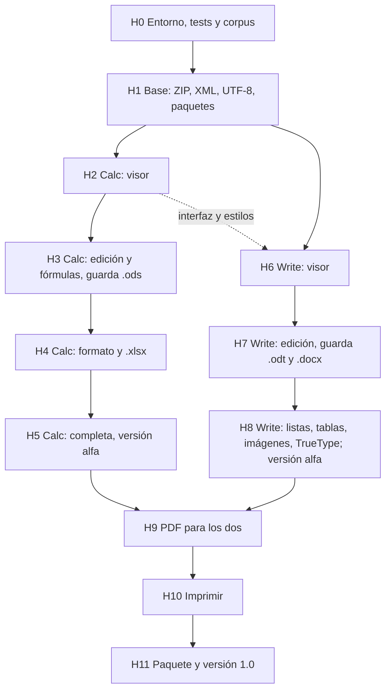

# 11. Plan de construcción

Los hitos en orden de dependencia, qué se entrega en cada uno, cómo se acepta y qué tareas de Dash necesita. Primero
Calc, porque su núcleo (números, fórmulas, rejilla) es más acotado que la maqueta de páginas de Write, y porque deja
hecha la base común que Write usa.

## 1. Dependencias entre hitos

H6 puede empezar cuando H1 esté hecho y H2 haya dejado la interfaz común (`core/interfaz`) y los estilos. A partir
de ahí Calc y Write pueden avanzar en paralelo.

## 2. Hitos

### H0 Entorno, tests y corpus

- **Entregables:**
  - Repositorio `FreeMEM/lorraine` con la estructura de [ARQUITECTURA](../ARQUITECTURA.md) § 3.
  - Worktree de Dash `~/Projects/FreeMEMLang/.worktrees/lorraine` (rama `lorraine`).
  - `tests/run.py`, adaptado del de Tachyon: compila `tests/test_*.dash` con `--fpu`, los ejecuta en FS-UAE y compara
    con `# expect-out:`.
  - Corpus de documentos en `tests/ficheros/`: hechos con LibreOffice por script (`tools/corpus.py`, con `soffice
    --headless`) en `.ods`, `.fods`, `.xlsx`, `.csv`, `.odt`, `.fodt`, `.docx`; más ficheros de Office de verdad con
    licencia libre (ver [08](08_PLAN_DE_PRUEBAS.md)).
  - `tools/volcar_lo.py`: saca de un documento, con LibreOffice, el volcado de referencia (valores de celdas,
    texto de párrafos) con el que se comparan las salidas de Lorraine.
  - Las herramientas de comprobación de [08](08_PLAN_DE_PRUEBAS.md) § 4.4 y § 4.5, sin tocar el sistema: ODF
    Validator, .NET y OOXML-Validator, un `venv` con openpyxl y python-docx en `~/.cache/lorraine-tools/`; el
    conversor `x2t` de OnlyOffice (ya instalado); los tests de funciones de LibreOffice bajados a `~/.cache`.
  - El entorno "a1200-030" de FS-UAE (68030 + 68882, sin JIT), la máquina de los objetivos.
- **Aceptación:** `test_hola` pasa en FS-UAE con la ROM 3.1 (no AROS) y en "a1200-030". El corpus se regenera con
  una orden. Cada herramienta de comprobación da su resultado con un fichero de LibreOffice.
- **Dash:** ninguna.

### H1 Base: ZIP, XML, UTF-8, paquetes

- **Entregables:** `core/zip` (leer; escribir sin comprimir), `core/xml_lector`, `core/xml_escritor`, `core/utf8`,
  `core/paquete` (detectar el formato, leer el manifiesto y las relaciones).
- **Aceptación:**
  - Lista las entradas de cada fichero del corpus y saca el texto de su `content.xml` o `document.xml`, igual que
    `unzip` y un lector XML en el PC.
  - Un ZIP escrito por Lorraine lo abre `unzip -t` sin errores.
  - Medida del lector XML con el `content.xml` más grande del corpus, comparada con expat compilado para 68k. Si va más
    de 3 veces más lento, se revisa la decisión A5.
- **Dash:** D5 (UTF-8), D6 (comprimir).

### H2 Calc: visor

- **Entregables:** modelo del libro (`calc/libro`), filtros de lectura `.ods`, `.fods`, `.xlsx` y `.csv` con el valor
  guardado de cada fórmula (decisión A8), formatos de número básicos, rejilla MUI con desplazamiento, pestañas de
  hojas, `core/interfaz` (abrir, avisos, Acerca de).
- **Aceptación:** cada libro del corpus muestra los mismos valores, ya formateados, que el volcado de LibreOffice.
  Un libro de 20.000 celdas abre en el tiempo de RNF-C01.
- **Dash:** D1, D3, D9; D17 medido.

### H3 Calc: edición y fórmulas, guarda .ods

- **Entregables:** escribir en celdas, selección con teclado y ratón, motor de fórmulas (lexer, parser, código,
  evaluador), recálculo con dependencias y circulares, el primer grupo de funciones (las marcadas H3 en
  [01](01_REQUISITOS.md) § 3.3), deshacer y rehacer, guardar `.ods` y `.fods`, menús.
- **Aceptación:**
  - Las fórmulas del corpus, recalculadas por Lorraine, dan lo mismo que el valor guardado por LibreOffice (con la
    tolerancia de [08](08_PLAN_DE_PRUEBAS.md)).
  - Un `.ods` guardado por Lorraine lo abre LibreOffice con los mismos valores y fórmulas, y pasa el validador de ODF.
  - Primera cifra de cobertura: cuántos tests de funciones de LibreOffice pasan (de las funciones H3, todos).
- **Dash:** D2, D4, D8, D11, D12, D13, D19, D20.

### H4 Calc: formato y .xlsx

- **Entregables:** guardar `.xlsx`; estilos de celda (fuente, negrita, cursiva, color, fondo, bordes, alineación,
  ajuste de texto), todos los formatos de número, anchos y altos, combinar celdas, barra de formato, comprimir al
  guardar (deflate).
- **Aceptación:** un `.xlsx` guardado por Lorraine lo abre LibreOffice igual que el original y pasa la validación de
  OOXML. Comprobación a mano en Excel de una muestra (ver R-05 en [10](10_RIESGOS_Y_PENDIENTES.md)).
- **Dash:** D14.

### H5 Calc: completa, versión alfa

- **Entregables:** copiar y pegar (también con otros programas), ordenar, rellenar series, insertar y borrar filas y
  columnas con las referencias ajustadas, buscar y reemplazar, inmovilizar filas y columnas, nombres definidos, el
  segundo grupo de funciones (H5), catálogo en español, paquete de Calc alfa.
- **Aceptación:** los casos de uso de Calc de [02](02_CASOS_DE_USO.md) se pueden hacer de principio a fin. Las
  pruebas de aceptación de Calc de [08](08_PLAN_DE_PRUEBAS.md) pasan.
- **Dash:** D7, D10, D15, D16, D17 (si la medida lo pide), D18.

### H6 Write: visor

- **Entregables:** modelo del documento (`write/documento`), filtros de lectura `.odt`, `.fodt`, `.docx` y `.txt`,
  estilos de párrafo y carácter con herencia, maqueta de líneas y paginación con las medidas de las fuentes de A13
  (leídas de sus TrueType; Arial → Liberation Sans, Calibri → Carlito...), pintor de páginas con zoom que de momento
  pinta con fuentes del Amiga parecidas.
- **Aceptación:** cada documento del corpus muestra el mismo texto, en el mismo orden y con el mismo formato de
  carácter que el volcado de LibreOffice. El número de páginas puede diferir (ver § 6.2 de la arquitectura).
- **Dash:** ninguna nueva (usa D5).

### H7 Write: edición, guarda .odt y .docx

- **Entregables:** cursor, escribir y borrar, seleccionar, aplicar estilos y formato, deshacer, buscar y reemplazar,
  repaginar desde el párrafo que cambia, guardar `.odt`, `.fodt`, `.docx` y `.txt`.
- **Aceptación:** escribir sin retraso (RNF-W02). Un documento guardado por Lorraine lo abre LibreOffice con el mismo
  texto y formato, y pasa los validadores.
- **Dash:** usa D11, D12, D13, D14, D18.

### H8 Write: listas, tablas, imágenes, TrueType; versión alfa

- **Entregables:** listas con viñetas y numeradas, tablas, imágenes (por datatypes), cabeceras y pies, saltos de
  página y secciones, pintar con las fuentes TrueType de A13 (caché de caracteres por tamaño, que vaya bien en un
  68030), paquete de Write alfa.
- **Aceptación:** los casos de uso de Write de [02](02_CASOS_DE_USO.md) de principio a fin. Las pruebas de aceptación
  de Write pasan.
- **Dash:** D23, D24.

### H9 PDF para los dos

- **Entregables:** `core/pdf`: exportar una hoja (con su área de impresión) y un documento a PDF.
- **Aceptación:** los PDF los abren `pdfinfo` y un visor del PC, con el texto que se puede copiar.
- **Letra:** la misma maqueta que en pantalla, con las fuentes de A13 incrustadas en el PDF (decidido el 2026-10-25).
  Primero enteras; recortarlas a los caracteres usados, después.

### H10 Imprimir

- **Entregables:** imprimir por `printer.device` las páginas como mapa de bits.
- **Aceptación:** imprime a fichero (`PRT:` redirigido) en el emulador; prueba a mano en una impresora.
- **Dash:** D21.

### H11 Paquete y versión 1.0

- **Entregables:** paquete LHA para Aminet con los dos programas, iconos, catálogos, guía de uso (AmigaGuide), puerto
  ARexx si D22 está hecho.
- **Aceptación:** se instala en un sistema limpio (3.1 y 3.2 con MUI) y los dos programas abren el corpus.

## 3. Versiones

| Versión | Al acabar | Qué es |
|---|---|---|
| Calc 0.1 alfa | H3 | Abre, edita, calcula y guarda `.ods`. Para probar. |
| Calc 0.5 alfa | H5 | Calc usable con `.ods` y `.xlsx`. |
| Write 0.1 alfa | H7 | Abre, edita y guarda `.odt` y `.docx`, sin tablas ni imágenes. |
| Write 0.5 alfa | H8 | Write usable. |
| Lorraine 1.0 | H11 | La suite, con PDF e impresión. |

## 4. Después de la 1.0

Por orden de lo que más se echa en falta: gráficos en Calc, formato condicional, comentarios, notas al pie, control
de cambios (leerlos y aceptarlos), RTF, conservar las partes del paquete que nada referencia (revisar la decisión A9),
un tercer programa (presentaciones) sobre la misma base.
